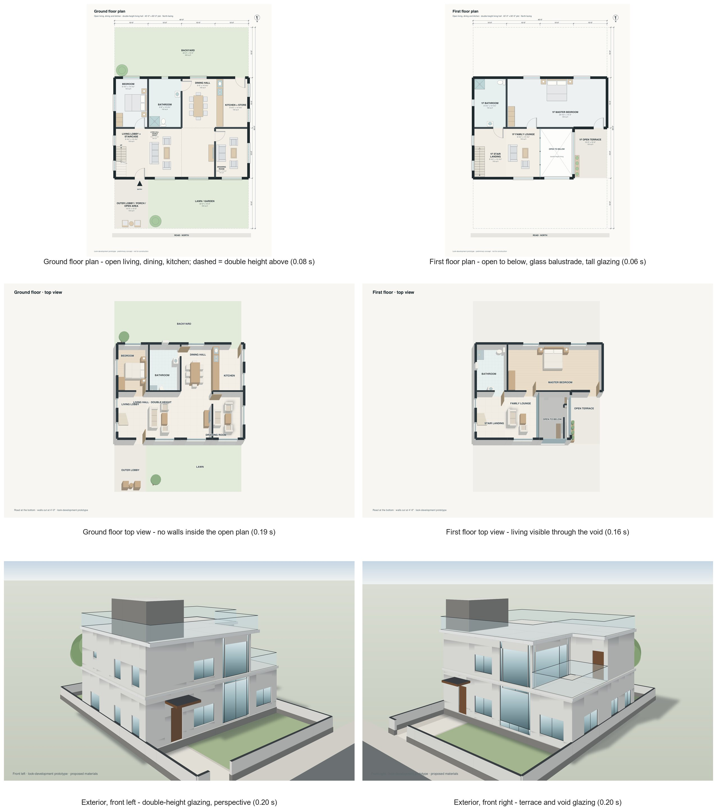
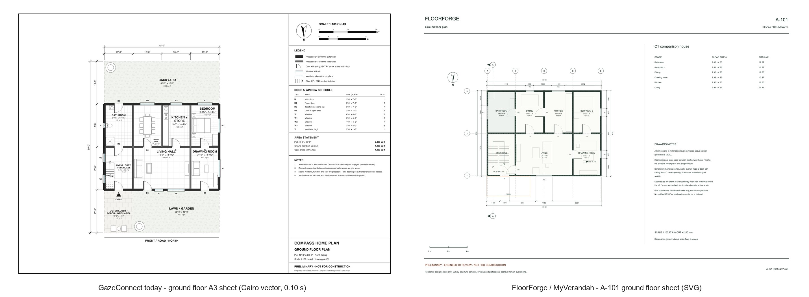
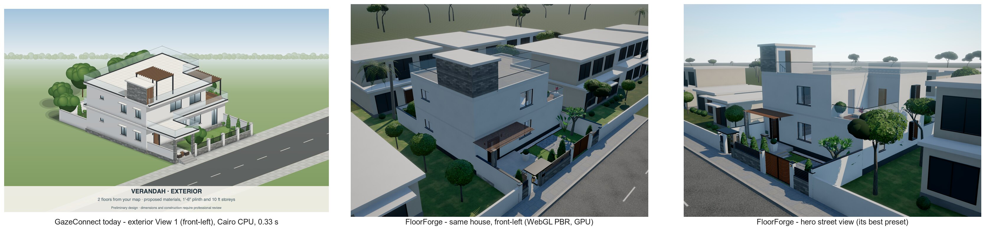
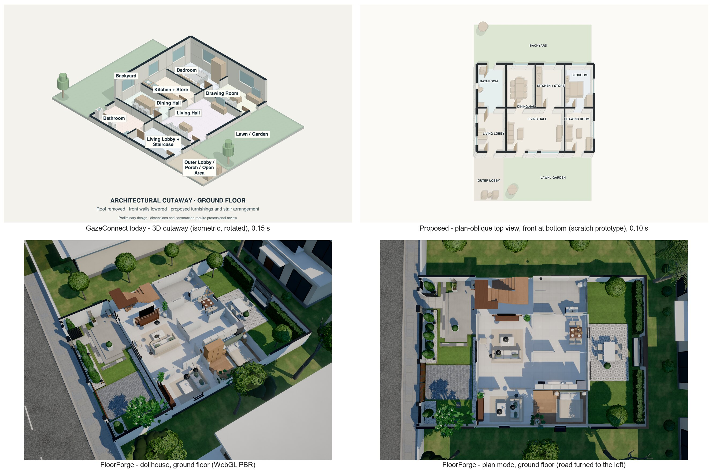

# Compass Refine and Plan Views: Implementation Plan

Status: proposal only, 14 Oct 2026. Nothing in the application was changed, installed, rendered at scale or committed while preparing it.

The **feasibility verdict and side-by-side comparison with MyVerandah come first**. The implementation plan after them is sized to what that comparison shows can credibly be achieved.

Scope: the Compass Map refinement workflow, its generated floor-plan views and its downloads. Gaze processing, calibration, dwell timing, speech, the keyboard, browsing and every other screen are out of scope and must stay as they are.

## 0. Sources and evidence labels

| Project | Path | Commit | Working tree |
|---|---|---|---|
| GazeConnect | `gazeconnect_v4` | `fae945b` on `ui/aac-visual-exploration` | clean |
| FloorForge / MyVerandah (reference only) | `Design_aesthtic_3d_home` | `be578f3` on `development` | uncommitted electrical-design work; the only change under `floorforge/` is one line in `server.py:145` that lets `electrical.html` be framed. No plan geometry is affected. |

The comparison runs used FloorForge's own `.venv` and an already-installed Playwright 1.62.1 with its cached Chromium 1234. They wrote only to a scratch folder and to `docs/compass-refine/evidence/`. Neither repository's tracked files changed, and nothing was installed.

Instructions read: GazeConnect `CLAUDE.md` and `AGENTS.md`. The relevant `AGENTS.md` entries are: Compass plan studio (4 Oct), room and exterior views (4 Oct), professional detail (5 Oct), FloorForge-style exterior (6 Oct), retirement of Refine Map (4 Oct, "Lower gaze controls") and removal of the optional renderer (4 Oct). FloorForge has no agent instructions; its README and `docs/` were used. Older documents such as `docs/3D_FLOORPLAN_TECHNICAL_AUDIT.md` were not trusted wherever the code disagrees with them.

Every major statement carries one label:

- **[S] Source-verified**: read in code at the commits above, cited as `file:line`.
- **[R] Runtime-measured**: measured here, on an Apple M5 Pro with 64 GB, macOS 26.3.1, Python 3.11.15, pycairo 1.28.0, shapely 2.1.2 / GEOS 3.13.1, ezdxf 1.4.3. This machine is much faster than the target, and these are not the Windows pins (`python/constraints.txt`: pycairo 1.29.1, ezdxf 1.4.4, numpy 2.5.3).
- **[D] Documented**: stated in the repository, for example in `AGENTS.md`, and not re-measured.
- **[W] Web, primary source**: vendor documentation, PyPI or the project repository, with a URL.
- **[P] Proposed**.
- **[NV] Not yet verified**.

Nothing labelled [R] says anything about the 4 GB Windows target. Every budget in §8 is a **target until measured on Windows**. [E] marks an estimate.

---

## Feasibility verdict and visual comparison (read first)

### Verdict

**Targets**: an 8 GB Windows 10/11 laptop with integrated graphics as the primary target, with gaze, UI and speech staying responsive; 4 GB as a separate, reduced-quality fallback.

| View | Verdict for the 8 GB laptop | 4 GB fallback |
|---|---|---|
| **A. 2D floor plans** | **Achievable within budget**, at the drafting standard of MyVerandah's sheets. On the same house both apps produce vector sheets. GazeConnect draws one in about 0.1 s [R], so the gap is drafting discipline and geometry, not rendering cost. | Same |
| **B. Whole-floor top projection** | **Achievable with compromises.** A CPU plan-oblique drawing, prototyped at 0.09–0.10 s per floor with a 70 MB process peak [R]: legible, front at the bottom, exactly aligned with the 2D plan. It will not look like MyVerandah's lit, textured dollhouse; that look comes from its GPU renderer. | Same, without blurred shadows |
| **C. Exterior** | **Achievable only as a clean architectural illustration.** Prototyped at 0.18–0.21 s per preset, with double-height glazing (see the look-development section). A CPU perspective with flat materials and projected soft shadows can carry MyVerandah's proportions, floating slabs, glazing, stone and timber accents and restrained composition. Its photographic qualities need the WebGL renderer, which is **unsuitable here** (reasons below). If the illustration fails the maintainer's review, ship A and B and defer C. | Off by default; one preset at reduced size on request |

Why the WebGL renderer is unsuitable:

- **Its photographic qualities all come from it**: physically based materials, sky lighting, ambient occlusion, shadow maps, procedural planting and the neighbourhood.
- **Cost, measured on this Mac** [R]: it adds about 374–390 MB to a browser with a GPU. Without a GPU it adds about 1.19 GB and takes 18.8 s to load.
- **No fallback**: Electron 44's Chromium has no automatic software WebGL fallback [W].
- **Shared GPU process**: it would compete with the UI and YouTube [D].

### How the comparison was made

- **One house, built in both apps.**
  - The house (`evidence/scripts/c1_spec.json`): 40 × 60 ft, North-facing, gate on the Left, ground and first floor, 10 × 15 ft cells. The house sits in rows 2–3. In GazeConnect row 1 is porch and lawn and row 4 is backyard. In FloorForge they become 15 ft front and rear setbacks.
  - The stair hall is in the same cell on both floors. The storey is set to 10 ft (3048 mm) in both apps.
- **GazeConnect**: built through the live studio path at `fae945b`.
- **FloorForge**: built at `be578f3` through its exact-geometry "Custom Plan" contract, on the same cell lines with its own 150 mm wall allowance, then its own "Suggest doors & windows" aid. Three openings were authored by hand, as a FloorForge user would: the entry and the two stair-hall doors.
- **A first layout was blocked by FloorForge.** With the house in rows 2–4, FloorForge refused to generate: a care room below 16 m², interior rooms without windows, and an unreachable stair hall [R]. The layout was then changed *for both apps*. That stricter validation is itself a finding.
- **How images were taken**:
  - GazeConnect PNGs and FloorForge SVG sheets: generated directly.
  - FloorForge 3D views: its own offline viewer (`preview.html`) in Playwright 1.62.1's headless Chromium 1234, using ANGLE Metal on this Apple M5 Pro: a real GPU, but not Iris Xe.
- **Raw numbers**: `evidence/measurements/macos_runs_2026-10-14.md`.

### Look-development prototype: open plan and a double-height living hall

After the decisions of 14 Oct (§12), a scratch prototype (`evidence/scripts/lookdev.py`, house `c2_spec.json`) was built on today's model. It renders the same plot with the open living + dining + kitchen + stair hall (no walls inside that space) and a double-height living hall (an "open to below" void over one living cell, edged by a glass balustrade). Views:

- 2D plans, road at the bottom;
- plan-oblique top views, with the ground floor visible through the void and blurred soft shadows;
- two-point perspective exteriors, with double-height glazing, transom and mullions, glass balustrades, a floating roof slab, reveals and soft ground shadows.



**Measured on this Mac [R]**:

| Step | Time |
|---|---|
| Model, both floors | 0.07 s |
| 2D plan | 0.06–0.08 s each |
| Top view | 0.16–0.19 s each |
| Perspective exterior (2400 × 1500, about 400–560 drawn faces) | 0.18–0.21 s each |

Process peak was 190 MB, mostly full-resolution blur buffers. Production blurs at half resolution [E: about −60 MB].

**What it shows**: the CPU route reaches a clean, believable *architectural illustration*. Perspective, double height, glass and soft shadows read clearly, at a fraction of WebGL's cost. It is **not photographic**: there are no textured materials, global light or rich landscape.

**Prototype defects, fixed in production**:

- patchy eave shading, because it was applied per wall strip;
- colliding labels in the open space;
- party-wall windows and walls straddling the plot line, inherited from today's code;
- a plain ground plane.

### Side-by-side images

- `evidence/cmp-1-2d-sheets.jpg`: GazeConnect's A3 ground-floor sheet against FloorForge's A-101.
- `evidence/cmp-2-exterior.jpg`: GazeConnect "View 1" against FloorForge's front-left and hero views.
- `evidence/cmp-3-top-views.jpg`: GazeConnect's current cutaway, the scratch plan-oblique prototype, FloorForge's dollhouse and FloorForge's plan mode.





### Quality gaps, and what closes them

| Dimension | GazeConnect today (same house) | MyVerandah / FloorForge (same house) | Closed by |
|---|---|---|---|
| Geometric correctness | 9″ walls straddle the plot line. Door tree: 1F master entered **through the bathroom**, bathroom door onto the backyard, lawn doors into living and drawing room [R]. Stair is lobby furniture. | Clear-room contract with walls inside the buildable line. Validator blocks unreachable or windowless habitable rooms. U-core aligned with the slab opening. Its door aid never routes through a bathroom, but did give Bedroom 3 a door from the master [R]. | **Geometry rules (CPU)** |
| Proportions | Same storey and plinth. Small punched windows with deep sunshades. | Glazing sized by use, slim frames, floating slabs with overhangs. | **Rules (CPU)** |
| Wall and opening detail (2D) | Comparable symbols and schedule, but tile and grass textures, heavy furniture, a label in a doorway ("DINING HALL"). | Uniform pen weights, openings chain, grid bubbles, level and section marks, very light furniture. | **Drawing (CPU)** |
| Stairs | Dog-leg drawn in the lobby; DN on the first floor; no void or guard line. | U-core with riser/tread note, section sheet, roof headhouse with a door. | **Geometry and drawing (CPU)** |
| Materials | Flat tints plus affine texture tiles. | Procedural physically based maps per material. | **Expensive rendering**; compromise: restrained flat tones and sparse lines |
| Lighting | One Lambert sun, contact gradients. | Sky image-based light, per-room probes, tone mapping, bloom. | **Expensive rendering**; compromise: two-tone shading |
| Shadows | Offset-hull decals. | 4096-px soft shadow maps. In plan mode they fall across rooms and reduce legibility. | **Partly CPU**: exact projected ground shadows, softened by blur |
| Depth | High parallel isometric (a game cue), rotated off the road axis. | Perspective camera, haze, neighbourhood. | **CPU perspective is feasible**; neighbourhood is not |
| Typography | Toy-API sans in bold capitals, sticker boxes in 3D. | One restrained sans at consistent small sizes; no labels in 3D. | **Drawing (CPU)** with a bundled font |
| Composition | Saturated lawn, cluster-ball trees, sky band, wide road. | Realistic street, neighbours, planting. | Restraint is free; realistic context needs GPU, so compromise: no neighbours, few simple trees |

### Reference features classified

| Class | MyVerandah / FloorForge features |
|---|---|
| **Achievable within budget** (CPU, existing stack) | Drafting conventions (three-tier chains, grid bubbles, levels, section marks, uniform pens, clear-size tags, title block). Clear-room contract with walls inside the plot. Reachability and daylight screening as named conflicts. Linked stair core with slab void, guards and roof headhouse. Glazing by use, slim dark frames, floating slabs with overhangs clipped to the plot. Stone and timber accent rules. Compound wall and gate. A framing solve for named camera presets. Plan hash with stale-result guard. |
| **Achievable with compromises** | Perspective exterior with flat materials and projected soft shadows. Planting as a few simple canopies. Plan-oblique top view with flat shading instead of a lit dollhouse. Terrace furniture and pergolas as simple solids. |
| **Unsuitable for this application** | The WebGL physically based renderer: probes, ambient occlusion, bloom, 4096-px shadow maps, procedural foliage, instanced grass, neighbourhood context. Walk and orbit modes (drag and keyboard, not gaze). Blender stills, removed by maintainer decision. FloorForge's automatic planner (moves and resizes rooms). Its plan and top framing that turns deep plots so the road is on the left. GSAP hero script and the unattributed hero image (licensing). |

### Three options compared

**[R]** = measured on this Mac. **[D]** = documented in the repository. **[E]** = estimate. **[NV]** = not yet verified. No percentage-of-MyVerandah figures are given, because none could be measured.

| Option | Expected visual quality | Application memory (Windows) | Peak generation memory | Generation time | Packaging cost | Complexity | Recommendation |
|---|---|---|---|---|---|---|---|
| **1. Improve the current CPU drawing pipeline** | 2D sheets at MyVerandah sheet level. Other views stay illustrations unless reworked. | [NV]. Floor-plan process today: 128 MB peak for 13 outputs on macOS [R]. | 128 MB [R] | 0.08–0.11 s per 2D sheet, PDF or DXF [R] | None; OFL font files added; OR-Tools and svgwrite removed | Medium | **Yes** |
| **2. Add lightweight static 3D-style projections (CPU)** | Legible furnished top view; perspective exterior illustration. Not photographic. | [NV]; about the same as option 1 [E] | 70 MB for two top views [R]. Exterior about today's +10.6 MiB per render [D][E]. | Top view 0.09–0.10 s [R]. Exterior about today's 0.31–0.35 s here [R] or the documented 1.66 s median [D]; perspective cost [E]. | None | Medium. The prototype was about 180 lines; a production view needs more plus tests. | **Yes** |
| **3a. Adapt MyVerandah rules and conventions** (no runtime component) | Better geometry, openings, stairs and proportions in every view | None | — | — | None (MIT, same author) | Medium–high: re-express its formulas on the GazeConnect cell contract | **Yes** |
| **3b. Embed MyVerandah's WebGL viewer** | Closest to MyVerandah realism | [NV]. On this Mac the viewer adds about 374–390 MB with a GPU and about 1.19 GB on CPU WebGL [R]. The app already uses 640–1,080 MB private during YouTube on the 8 GB laptop, which had about 1.4 GB free before launch [D]. | FloorForge pipeline 191 MB [R], plus the viewer | Pipeline 2.6 s, then on the M5 GPU 0.6 s load and 0.1 s per still; on CPU WebGL 18.8 s load and 3.2 s per still [R] | Viewer 1.14 MB. Its Python scene path brings trimesh (4.6 MB installed), ReportLab (8.9 MB) and SciPy (99 MB), or needs a rewrite [R]. | High: GPU lifecycle, gaze-operable controls, memory governor, driver variance, plus WebGL availability risk | **No** for the gaze app |

### What remains unverified, and the benchmarks needed

No representative Windows hardware was available to this review. **Everything about Windows memory, timing and gaze impact is unverified.** Two benchmarks are needed.

**B1 (required)**: the §8.4 protocol on the installed app.

- Machines: the maintainer's 8 GB Iris Xe laptop and a 4 GB Windows 10 laptop.
- Scenario: C1 plus the §11 fixtures; all views and presets; 20 generate/cancel cycles; Kokoro speech and keyboard typing running at the same time.
- Record:
  - per-process private bytes: Electron main, renderer and GPU; backend; Kokoro; prediction worker; floor-plan process;
  - available and committed memory, and page-ins per second;
  - gaze-loop latency, renderer frame gaps and per-view times.
- Pass: the §8.3 targets.

**B2 (only if option 3b is ever reconsidered)**: open C1's `preview.html` in an Electron 44 window beside the running app on the 8 GB laptop.

- At 1366 × 768, Performance quality, record:
  - GPU-process private bytes;
  - frame time and still time;
  - WebGL context loss;
  - gaze-loop latency while orbiting.
- Repeat with YouTube playing.

**Visual acceptance**: the maintainer reviews the comparison sheets and the new views on the laptop at 1366 × 768 and 1920 × 1080.

### What this means for the plan below

- The plan delivers A, then B, then C, all on the CPU (options 1 + 2 + 3a).
- The exterior stays gated (Phase 6).
- Nothing from MyVerandah ships at runtime.
- Budgets (§8.3) treat 8 GB as primary and 4 GB as the reduced *Light* preset: 2D and top view, no exterior by default.

---

## 1. Why the present views look toy-like or inaccurate

**How the evidence was gathered [R].** An asymmetric two-floor map was run through the live studio path (`compass_presentation.options` → `render`); the fixture is in Appendix A. The map is a 30 × 50 ft plot, North-facing, with the gate on the Left. The ground floor has 10 rooms, including two-cell living, drawing, master and stair rooms. The first floor has 7 rooms, with the first-floor master partly over the backyard.

The studio returned one option, "My map preview", marked `valid: false`. It had **0 doors on either floor**. Renders took 0.09–0.36 s and the DXF 0.03 s. The whole probe peaked at 121 MB RSS. The existing suites (`test_compass_presentation`, `test_compass_room_views`, `test_gazeplan_candidates`) pass: 35 tests in 7.8 s, 194 MB peak RSS.

| # | Finding | Evidence | Consequence |
|---|---|---|---|
| 1 | **Plans are rotated for the most common plot shape.** On screen, any plot deeper than it is wide is turned 90° with the road on the left. | `compass_drawing.py:520-524` [S]; the 30 × 50 render says "front / road on the left" [R] | The map puts the road at the bottom, but the plan the user sees does not. Most Indian plots (30 × 40, 30 × 50, 40 × 60) take this rotated path. |
| 2 | **The map contradicts itself for North- and South-facing plots.** The edge labels say LEFT · WEST / RIGHT · EAST for a North-facing plot. The compass rose on the same screen rotates N to the bottom, which puts East on the left. | Labels: `compassDirections.ts:14-15`. Rose: `CompassMapScreen.tsx:834`. The drawing (`compass_drawing.py:464-466`) and DXF (`compass_presentation.py:251`) agree with the rose. [S] | For half of all facings the user is told the wrong side for east and west. That affects windows, sun and Vastu reasoning. |
| 3 | **One failed size check removes every door from both floors.** Any validation issue makes the plan a "concept", and concepts get `doors: []`. The width check also runs per **cell**, not per room, so a 15 × 12.5 ft two-cell drawing room fails. | `compass_presentation.py:147`; `candidates.py:598-604` [S]. In the probe, drawing (15 × 12.5) and 1F master failed; the doorless sheets show no entrance [R]. | Plans read as sealed boxes, with no circulation or entrance. This is the main "inaccurate" impression. |
| 4 | **Every boundary between two rooms is a full wall.** There is no open plan, opening or partition logic. | `compass_architecture.py:275-282` [S] | Living, dining and kitchen are boxed apart, which is the opposite of the preferred layout. |
| 5 | **Doors follow a breadth-first spanning tree in sorted placement-ID order,** not the uses of the rooms. Each door sits at the midpoint of the longest shared edge. | `candidates.py:528-539, 339-345` [S]. In the comparison house [R]: the 1F master is entered through the 1F bathroom, the bathroom opens onto the backyard, and the lawn has doors into the living and drawing rooms. | A bedroom can be entered through a bathroom or another bedroom. Door positions block furniture walls. |
| 6 | **The stair is furniture inside a "Living Lobby + Staircase" or "Dining Hall + Staircase" room.** Fallback flights of 12 risers cannot climb the 10 ft storey (16 risers are needed), and their treads are 9″ and 6″. There is no first-floor void with a guard, and headroom is never checked. | `CompassMapScreen.tsx:116-117`; `compass_furniture.py:490-491, 259-263`; `compass_standards.py:25-29` [S] | It is drawn but not reserved: the "insufficient stair symbols inside a dining room" problem. |
| 7 | **Walls straddle the plot boundary.** A 9″ outer wall is centred on the plot line, so 4.5″ of it lies outside the plot. The exterior widens its site box to match. | `compass_architecture.py:385`; `compass_exterior.py:1132` [S]; wall footprint bounds −0.375…30.375 × −0.375…50.375 ft [R] | Built form crosses the property line, and the dimension chains cannot describe it honestly. |
| 8 | **Minimum sizes are checked on centre-line rectangles, per cell,** against clear-size minimums (NBC 2016 values in `nbc_standards.py`). | `candidates.py:592-604` [S] | Rooms pass that are too small when clear, and fail when they are actually large enough. |
| 9 | **The map shows rounded sizes.** A 30 × 50 ft plot's cells are labelled "8×13 ft" when they are 7′-6″ × 12′-6″. | `CompassMapScreen.tsx:1095-1096`; `ArchitecturalCell.tsx:227,310`; `floorplanApi.ts:380-381` [S] | The map disagrees with the drawings' dimension chains. |
| 10 | **The visual language is "toy".** It cycles pastel tints per room (`ROOM_TONES`), adds tile and plank patterns in every room, puts sticker-boxed labels on the 3D view, and uses an isometric "game" camera with saturated lawns, cluster-ball trees, a sky band and a wide road. Labels collapse to tiny text in narrow furnished rooms. The Cairo toy-font API draws "sans-serif", which is a different face on Windows and macOS. | `compass_presentation.py:33,144`; `compass_drawing.py:28-30, 88-129`; `compass_exterior.py:1123-1200`. The renders show LIVING HALL as ~7 px text on a wall line [R]. | Reads as an illustration, not a drawing. Output is not identical across platforms. |
| 11 | **Upper floors lack context.** They draw no "roof below" or "open to sky". A room over open ground has no support note. Windows go on side boundaries of a *Middle* plot (party walls). | Exposure ignores `plotType` (`compass_architecture.py:295`) [S]. The probe's 1F master over the backyard produced no note [R]. | Concepts look buildable where they are not. |
| 12 | **"Alternatives" move shared walls by 0.8–1.2 ft,** although the docstring says "at most one foot". | `candidates.py:3-4` versus `:305` [S] | Invented dimensions, which conflicts with "geometrically faithful". |
| 13 | **Survey answers are ignored by the active path.** Setbacks, open-plan choice, staircase type, main-door room and corridor width never reach it. Setbacks also contradict a grid that covers the whole plot. | `floorplanApi.ts:469-470`; `compass_presentation.py` has no survey input [S] | Two sources of truth, with nothing reconciling them. |
| 14 | **Multi-cell rooms may be disconnected, and the expansion path is dead code.** `PLACE_ROOM` adds any cell to the armed room. `pendingExpansion` is never set to a non-null value. | `CompassMapScreen.tsx:597-690`; `grep pendingExpansion:` shows only `null` and history restores [S] | Rooms can be scattered, and the room/region identity is ambiguous. |
| 15 | **Downloads may open a mouse-only Save dialog.** The main window has no `will-download` handler; Electron's documented default prompts a native dialog. | `grep will-download electron/` finds only the embedded-page session (`browserSafety.ts:124`) [S]. Electron's docs say that without `setSavePath` it "usually prompts a save dialog" ([DownloadItem](https://www.electronjs.org/docs/latest/api/download-item)) [W]. Not yet observed in the packaged app [NV]. | A gaze selection ends behind a dialog that gaze cannot operate. `AGENTS.md:112` forbids this pattern elsewhere. |

**In one sentence:** the geometry contract is too weak for the views it feeds: one owner per cell, walls on grid lines, no notion of an open boundary, stairs as furniture. On top of that, the presentation layer tries to look rich by adding colour, pattern and camera drama rather than drafting discipline.

---

## 2. Current architecture map

```
CompassMapScreen.tsx  (reducer: 16-cell grid + placements per floor; v1 draft)
 ├─ persistence: sessionStorage gazeconnect_compass_progress_v1, localStorage compass_persistent_backup,
 │               compass_last_session_backup, gazeconnect_compass_accepted_plan_v1; backend save_survey
 │               → survey_data/gaze_survey_data.json (compass_map, no gate_position)          [S]
 └─ handleGenerateFloorPlan → compileCompassPayload (exact cellRects, rounded cell_size_ft)
       + attachCompassFloorRefinements (legacy per-floor refinements)                           [S]
        └─ CompassPlanStudio.tsx (pages: plan, views, styles, rooms, notes, downloads)
             └─ floorplanApi.compassRequest (60 s deadline, 429 retries; abort not forwarded)   [S]
                  └─ preload floorplan.request → main.ts IPC (9-route allowlist, 2 MiB body,
                     120 s) → HTTP 127.0.0.1:5050 (packaged: always 5050)                        [S]
                       └─ tools/floorplan_server.py (Flask dev server, threaded; eagerly imports the
                          legacy v5 engine and OR-Tools)                                        [S]
                            ├─ /compass/options → compass_resources.job() → compass_presentation.options
                            │     └─ gazeplan_engine_v5.candidates: _normalise_map, _validate,
                            │        generate_layout_candidates (up to 4 "alternatives")
                            └─ /compass/render → compass_resources.render (16 MiB / 12-item LRU)
                                  └─ compass_presentation.model → compass_architecture.details
                                       → compass_furniture (stair, furniture)
                                     ├─ compass_drawing: draw_2d (screen), draw_sheet (A3), draw_3d (BSP)
                                     ├─ compass_exterior.draw_exterior (BSP, 14 texture tiles)
                                     └─ export_dxf (ezdxf R2010, millimetres)
Legacy, kept only so old saves stay readable: "Open saved refinements" → PlanReviewModal
  → /candidates (+ floorplan_fusion_v1 survey fusion) and /candidates/adjust
  → FloorPlanViewerModal → /generate, /generate-advanced → gazeconnect_floorplan_v5.CairoFloorPlan  [S]
Unreachable from the interface: /generate-all and /preview (client functions without callers);
  /v5/generate and /fusion-report (not in the Electron allowlist) → gazeplan_engine_v5.engine
  (treemap, OR-Tools CP-SAT, vastu, renderer_v5, dxf_exporter_v5)                                [S]
Survey (FloorPlanSurveyScreen.tsx, surveyQuestions.ts): only prefills the Compass foundation
  (facing, plot size, type, floors) in the active path.                                           [S]
```

Active modules are `compass_presentation`, `compass_architecture`, `compass_furniture`, `compass_drawing`, `compass_exterior`, `compass_standards`, `compass_resources`, and two pieces of `gazeplan_engine_v5`: `candidates.py` and `nbc_standards.py`. Everything else under `gazeplan_engine_v5/`, `gazeconnect_floorplan_v5.py` and `floorplan_fusion_v1.py` is legacy or optional. [S]

### Geometry inconsistencies found

| Area | Inconsistency | Labels |
|---|---|---|
| Orientation | Map edge labels (N/S mirrored) ≠ map rose = drawing north arrow = DXF north arrow. The 2D screen plan rotates tall plots; the A3 sheet and DXF do not. The 3D and exterior cameras are unnamed ("View n of 4"). | [S] |
| Dimensions | Map labels and `cell_size_ft` are rounded; geometry uses exact rectangles. Chains measure to wall centre lines, but outer walls are centred on the plot line. | [S] |
| Room identity | One placement per room *type* (`PLACE_ROOM` keys by `roomId`), so two bedrooms cannot be told apart. Disconnected cells are merged into one "room". `commonBath` is folded into `bathroom` on load. | [S] |
| Validation | Concept previews drop all doors. Sizes are checked per cell on centre lines. The stair overlap check (3 × 6 ft common rectangle) ignores the real flight footprint. | [S] |
| Stair | The ground floor "Lobby + Staircase" (up to 2 cells) and the first floor "Stair Landing" (1 cell) are aligned by a hint. Fallback flights do not reach the next floor. | [S] |
| Persistence | The backend copy omits `gate_position`. The draft `version` is never checked. Legacy refinements are copied to the active floor only. | [S] (runtime agent report) |
| Two grids | The survey's 4 × 4 "Layout" slots (`plot_r1_s1…plot_r4_s4`) and the Compass grid are separate, with no reconciliation. | [S] |
| Naming | `PlanAdjustment.direction` 'N/E/S/W' means screen up/right/down/left (`candidates.py` `_room_size` step map), not compass directions. | [S] |
| Exterior | Concept previews have no main door, so no gate path. Rooms over open ground float without a support note. | [S][R] |

### Legacy refinement structures that still exist

`src/types/advancedMap.ts` keeps `subCellSplits {parentCell, splitDirection: 'vertical'|'horizontal', roomA, roomB, roomAPct 25–75}`, `customEdges` (full_wall | half_wall_glass | open_archway | no_wall), `voidMarkers`, `cellRotations`, `cellExpansions`, annotations, vastu and accessibility markers, and `cellLayouts` [S].

The legacy renderer reads a vertical split as **A = left (smaller x), B = right** and a horizontal split as **A = back, B = front**. `roomA`/`roomB` are room *type* IDs, and `roomAPct` is not clamped (`gazeconnect_floorplan_v5.py:315-334`) [S].

The studio refuses any non-empty refinement (`candidates.py:164-176`) and sends such plans to the compatibility viewer. `AGENTS.md:122` forbids exposing the old editing tools again [D]. The new feature therefore needs its own canonical contract (§4), with a one-way, lossless migration for the subset that fits.

---

## 3. Research comparison and recommended minimal toolchain

### 3.1 What the problem actually needs

The geometry is small:

- at most 32 axis-aligned regions per floor, on two floors;
- exact noding and polygon set operations;
- wall offsets;
- a bounded, explainable search for doors and the stair;
- one vector 2D drawing pipeline (PNG/SVG/PDF);
- one CPU projected-view family;
- DXF.

The existing baseline already covers all of it. The question is what to remove, not what to add.

**Measured.** The toolchain review ran one timing test in the repository's macOS venv, with shapely 2.1.2 [R]. A 26-region floor with 50 wall-sharing pairs went through a complete geometry pass in **1.7 ms**: set_precision, coverage check, coverage union, STRtree adjacency and shared-wall lengths. Trying all **104 stair candidates, each with its own door tree, took 0.28 ms**. Normalised hashes were identical across runs.

No published memory or performance figures were found for any candidate at this scale [W].

### 3.2 Comparison

Sizes are compressed CPython 3.12 `win_amd64` wheels from PyPI file listings. "Hook" means a hook in `pyinstaller-hooks-contrib`.

| Need | Candidate | Verdict | Evidence and reason | Licence | Windows wheel |
|---|---|---|---|---|---|
| Geometry | **Shapely 2.1.2** (baseline; GEOS 3.13.1) | **Keep** | Has `set_precision`/`grid_size` overlays, `coverage_*` (2.1+, GEOS ≥ 3.12), `make_valid`, `shared_paths`, `polylabel`. Fixed-precision overlay is robust ([GEOS OverlayNG](https://libgeos.org/doxygen/classgeos_1_1operation_1_1overlayng_1_1OverlayNG.html)). `ops.unary_union` has no `grid_size`, so use `union_all`. 2.2.0 came out on 7 Oct 2026; wait. | BSD-3; GEOS LGPL-2.1 as separate DLLs ([wheel licence](https://github.com/shapely/shapely/blob/main/ci/wheelbuilder/LICENSE_GEOS)) | 1.72 MB, hook ([PyPI](https://pypi.org/project/shapely/2.1.2/#files)) |
| Geometry | pyclipper 1.4.0 | Optional, later | Integer offsetting. Shapely `buffer` on the lattice already suffices. | MIT/Boost | 0.10 MB, no hook |
| Geometry | pyclipr (Clipper2), scikit-geometry, CGAL | Reject | Thin maintenance, or GPL/LGPL-3 and 25 MB, for rectangles | various | — |
| Graph | networkx 3.x (baseline, legacy engine only) | Retire with legacy | A dict plus breadth-first search or Dijkstra over ≤ 32 nodes is enough | BSD-3 | 2.1 MB |
| Search | **Bounded deterministic enumeration** (in-house) | **Keep / adopt** | 0.28 ms for 104 stair candidates with door trees [R]. Explainable, tie-breaks fixed. | own | — |
| Search | OR-Tools CP-SAT 9.15 (baseline, legacy only) | **Retire** | Loaded at server start through the legacy engine; `cp_model` imports pandas when it loads ([source](https://github.com/google/or-tools/blob/stable/ortools/sat/python/cp_model.py)). The legacy solver uses 8 workers with a wall-clock limit, which is not reproducible across machines ([parameters](https://github.com/google/or-tools/blob/stable/ortools/sat/sat_parameters.proto)). | Apache-2.0 | 23.9 MB + pandas 9.7 MB + protobuf, absl-py, immutabledict ([PyPI](https://pypi.org/project/ortools/9.15.6755/#files)) |
| Search | python-constraint2, Z3, SciPy `milp` / HiGHS | Reject | No benefit over enumeration; Z3 17 MB, SciPy 37 MB | BSD/MIT | — |
| 2D drawing | **pycairo 1.29.1** (baseline) | **Keep** | One API for PNG, SVG and PDF. 1.29.2 (4 Oct 2026) updates the bundled cairo 1.18.4 → 1.18.6 ([changelog](https://pycairo.readthedocs.io/en/latest/changelog.html)); adopt after it has settled. | LGPL-2.1-only OR MPL-1.1; cairo, zlib, pixman and libpng statically linked ([cairo-win-build](https://github.com/pygobject/cairo-win-build)) | 0.85 MB |
| 2D drawing | skia-python, reportlab, matplotlib | Reject | Duplicate Cairo at 2–11 MB with no gain | various | — |
| 2D drawing | svgwrite 1.4.3 (baseline) | **Remove** | Archived 19 Aug 2024 ([repo](https://github.com/mozman/svgwrite)). Nothing imports it; it appears only in a comment in `gazeconnect_floorplan_v5.py:11`, `requirements.txt`, `constraints.txt` and `scripts/windows/check_python.py` [S] | MIT | 0.07 MB |
| SVG → PNG | resvg-py, CairoSVG | Optional / reject | Not needed: Cairo renders PNG directly. CairoSVG needs a separate `libcairo-2.dll`. | — | — |
| Text | **fontTools** (installed as an ezdxf dependency) + Atkinson Hyperlegible Next TTF | **Use** | Glyph outlines give platform-independent text. The OFL font is already shipped for the UI. | MIT / OFL-1.1 | already present |
| Projected views | **In-house projection + Cairo + axis-aligned BSP** (baseline) | **Keep** | Deterministic vector output on the CPU. Plan-oblique and perspective variants reuse it. | own | — |
| Projected views | three.js in the renderer | **Defer / reject for now** | Electron 44 is Chromium 152 ([releases](https://releases.electronjs.org/releases.json)). Chromium removed the automatic SwiftShader fallback for WebGL on desktop (M139; [chromestatus](https://chromestatus.com/feature/5166674414927872)), so a missing or failing GPU means no view at all. The GPU process is shared with the UI and YouTube, and the Iris Xe stalls documented in `AGENTS.md:30,33` make it a risk to gaze. | MIT | 2.1 MB JS |
| Projected views | pyrender, moderngl, VTK, Open3D | Reject | Need OpenGL 3.3+, EGL or OSMesa, or are 77–80 MB | — | — |
| CAD | **ezdxf 1.4.4** (baseline) | **Keep** | Writes R12–R2018; `units` must be set explicitly (default 6 = metres); `audit()` checks structure only ([docs](https://ezdxf.readthedocs.io/en/stable/drawing/drawing.html)). Profile in §9.3. | MIT | 2.96 MB |
| 3D interchange | trimesh 5.x (GLB) | Optional, later | numpy only; GLB opens in SketchUp desktop, Blender and Autodesk Viewer (§9) | MIT | 0.75 MB, hook |
| 3D interchange | IfcOpenShell 0.9.0, pygltflib | Reject for now | IFC only once a semantic export is validated; LGPL-3, 50 MB | — | — |
| ML / Hugging Face | House-GAN++, HouseDiffusion, Graph2Plan, Tell2Design, GSDiff, MaskPLAN; HF model search | **Reject all** | Each generates a *new* layout, which would replace the person's grid. Licences are research-only, non-commercial, GPL-3 or missing. MaskPLAN needs a ≥ 24 GB GPU. HF shows only segmentation, VLM and text-to-image models ([search](https://huggingface.co/models?search=floor%20plan)). Generative appearance never replaces authoritative geometry. | — | — |

### 3.3 Recommended minimal toolchain [P]

- **Keep** shapely 2.1.2, pycairo, ezdxf 1.4.4, numpy and Pillow. Use fontTools for glyph outlines.
- **Add** no Python package. Only the OFL TTF font files.
- **Remove** `svgwrite` now; it is unused.
- **Retire** OR-Tools and networkx together with the unreachable legacy `/v5` route. Remove pandas, protobuf, absl-py and immutabledict too, if nothing else in the floor-plan bundle needs them [NV]. Until then, import them lazily.
- **Later, only on request**: trimesh for a GLB download.
- **Reject** everything else, including WebGL/three.js for these views.

Determinism settings are part of the toolchain:

- integer lattice;
- `union_all(grid_size=1)`;
- noding before any coverage operation;
- `normalize()` before hashing;
- fixed PDF and DXF timestamps;
- no parallel or time-limited search.

**Not verified [NV]**: installed sizes and RAM cost on Windows, including OR-Tools with pandas at start; PyInstaller behaviour for packages without hooks; cross-machine identity of Cairo rasters (glyph outlines remove the font variable); WebGL behaviour inside Electron specifically. All timings are from macOS.

---

## 4. Authoritative geometry schema

### 4.1 Principles [P]

1. **One intent, one derived model.** The draft stores only what the person chose: plot facts, which cells are split, which rooms own which regions, and two layout preferences. Walls, openings, stair, furniture, windows, views and exports are all *derived* by one Python module from one `PlanModel`. No renderer reads the raw map.
2. **Identity ≠ use ≠ region ≠ boundary.** A room has a stable `id` (identity), a `use` (bedroom, kitchen…) and a set of `regions` (where it is). Boundary types are derived per edge. Two neighbouring regions with different labels do not automatically get a wall. Two separate bedrooms with the same use never merge.
3. **Constraints, not suggestions.** User regions are never moved, resized, mirrored or reassigned by the planner. When something cannot be satisfied, the model returns a typed conflict with a specific adjustment the person can choose.
4. **Exact arithmetic.** All plan geometry lives on an integer lattice, so equality is exact, noding is exact and output is reproducible.

### 4.2 Units and coordinate frames [P]

- **Plan frame**: origin at the plot's front-left corner. +x runs along the road, to the right as seen on the map with the road at the bottom. +y runs away from the road toward the back. +z points up. Row 1 is y ∈ [0, D/4); row 4 is the back. Column 1 is the left. This is exactly `compassMath.cellToRect` and `candidates._cell_rect` today [S].
- **Lattice unit u = ⅛ inch = 3.175 mm exactly.** Plot sides must be whole inches; the current options are whole feet. Cells (W/4, D/4) and half-cells (W/8) are then always integers in u. So are walls (9″ = 72 u, 6″ = 48 u), doors (3′-0″ = 288 u), treads (10″ = 80 u), risers (7½″ = 60 u) and the storey (10′ = 960 u). For a 200 ft plot, coordinates stay below 2¹⁹ and products below 2⁵³, so GEOS doubles stay exact; overlays also pass `grid_size=1`.
  - Checked here with shapely 2.1.2 / GEOS 3.13.1, the pinned Shapely version [R]. A 30 × 50 ft plot with one split cell gives 17 regions with integer coordinates, and their `union_all(grid_size=1)` area equals the plot area exactly. `polylabel` puts the label point inside an L-shaped room.
  - **Noding is required, not optional.** Passed as an array, the raw rectangles are not a valid coverage: `coverage_is_valid` returns False, with 4 invalid edges, because the unsplit neighbours lack the half-point vertex. Once the half-points are inserted (for example `shapely.segmentize` at half-cell spacing) the coverage is valid [R]. The toolchain review saw `coverage_union_all` raise a TopologyException on a larger raw case.
  - Integer millimetres were considered and rejected. They are not exact for this app's imperial inputs: a 9″ wall is 228.6 mm, and a half-cell of a 25 ft plot is 952.5 mm.
- **Derived transforms**, each a single function with a test:
  - *screen/sheet*: (x, y) → (left + x·s, top + (D − y)·s). The road is always at the bottom and is never rotated or mirrored. A tall plot gets a portrait sheet (A3 portrait), not a rotated plan.
  - *top projection*: z offsets the plan by (+0.22 z, +0.42 z) in plan units before the same screen transform. These are the prototyped values (§6.3).
  - *DXF*: inches = u ÷ 8 in the feet-inch file and mm = u × 3.175 in the metric file (§9.3), both with the same origin and axes (+Y away from the road).
  - *exterior cameras*: four named presets defined in plan coordinates (§6.4). Changing the angle never changes model coordinates.
- **North**: derived only from `facing`, the direction the road side faces. North in plan coordinates: South-facing (0, +1), North (0, −1), East (+1, 0), West (−1, 0). The plan's left edge (−x) is then: South-facing → West, North → East, East → South, West → North. Map labels, rose, 2D, top projection, DXF and exterior all consume this one function. Fixing `compassDirections.ts` (North: left East / right West; South: left West / right East) is part of Phase 1.

### 4.3 Persisted intent: `CompassPlanV2` [P]

```ts
// src/types/compassPlan.ts (mirrored by tools/compass_schema.py; shared JSON test vectors)
export type CellKey = `r${1|2|3|4}_c${1|2|3|4}`;           // r1 = front/road, c1 = left
export type RegionKey = CellKey | `${CellKey}.L` | `${CellKey}.R`;
export type FloorId = 'ground' | 'first';

export interface CompassPlanV2 {
  schema: 'gazeconnect.compass-plan';
  version: 2;
  plot: {
    widthIn: number; depthIn: number;                       // whole inches, 180..2400
    facing: 'North' | 'East' | 'South' | 'West';            // direction the road side faces
    gate: 'Left' | 'Center' | 'Right';
    plotType: 'Middle Plot' | 'Corner Plot' | 'Independent';
    sidesOpen?: { left: boolean; right: boolean };          // answer to the party-wall question (§4.7)
    secondRoad?: 'Left' | 'Right';                          // Corner Plot only
  };
  storeys: 1 | 2;                                           // what the person asked for
  floors: { ground: FloorIntent; first?: FloorIntent };
  choices: { drawingRoom?: 'separate' | 'open'; kitchen?: 'open' | 'closed' };
  legacy?: { fromVersion: 1; refinements: unknown; reason: string };   // verbatim, read-only
}
export interface FloorIntent {
  splits: CellKey[];          // sorted, unique: each is exactly 50 % left | 50 % right (screen-relative)
  rooms: RoomIntent[];        // sorted by id
}
export interface RoomIntent {
  id: string;                 // e.g. 'g-bedroom-2': floor prefix, use, monotonically increasing n; never reused
  use: RoomUse;               // existing ROOM_LIBRARY ids, plus 'passage' (both floors) and 'void'
                              // ("Open to below · double height", first floor only); decided 14 Oct
  regions: RegionKey[];       // sorted, unique, edge-connected
}
```

**Invariants**, checked identically in TypeScript (`src/utils/compassPlan.ts`) and Python (`tools/compass_schema.py`):

- A split cell has only `.L`/`.R` regions; an unsplit cell has only its whole key.
- Each region has at most one owner. Unowned regions are "unassigned": they are never treated as corridors.
- Every room has at least one region, and its regions are edge-connected (shared edge > 0). A neck narrower than 3′-0″ is a warning.
- At most one stair host per floor (`staircase` or `diningStaircase` on the ground floor, `ff_stairLanding` on the first).
- A `void` region (first floor only) must lie over ground-floor regions owned by indoor public rooms: living, dining or stair hall, or drawing room when it is open. It is part of the first-floor envelope, so it is roofed. It can be a whole cell or a half (Refine).
- Room uses respect the floor's catalogue (`GF_IDS` / `FF_IDS`).
- `left`/`right` always means `.L` = smaller x. This matches the legacy vertical-split meaning, so legacy data migrates without reinterpretation.

**Display labels** are derived and never stored. When a use occurs once on a floor, the room takes the library label ("Bedroom"). When it occurs more than once, rooms are numbered in ID order ("Bedroom 1", "Bedroom 2").

### 4.4 Derived model: `PlanModel` (Python, `tools/compass_geometry.py`) [P]

The model is immutable and its canonical JSON carries a SHA-256 `modelHash`. Per floor it contains:

- **regions**: key, integer rectangle, owner.
- **rooms**: id, use, label, zone (§7.1), gross polygon, clear polygon (after walls), clear W × D when rectangular, area (gross at grid, plus clear), label anchor (`shapely.ops.polylabel` of the clear polygon minus fixtures and swing zones).
- **edges**: every boundary segment, noded at all region corners, including the half-points that a split creates against unsplit neighbours. Each edge has its two sides (room, `outdoor:<id>`, `unassigned`, `site`), its `kind` (none | open | opening | partition | exterior | site), thickness, placement rule (centred, or inward for exterior), and a `reason` code.
- **wallRuns**: collinear edges with the same kind and owners merged, as in FloorForge `custom_plan.wall_runs` [S], with stable IDs (sha of endpoints and owners). Each run has an integer polygon.
- **openings**: doors (host run, offset, width, hinge, swing room, type, tag); windows and ventilators (host run, offset, width, sill, head); cased openings. Each has a reason.
- **stair**: core rectangle, type, flights, landings, first riser, up direction, host room, per-floor role (start | arrival | roof), upper-floor void and guards, mumty.
- **fixtures**: furniture, bounded per room.
- **supports**: proposed columns where an upper floor or roofed outdoor area has no wall below (§7.6), always labelled "proposed — verify".
- **notes**: `{code, severity: info | warning | conflict | infeasible, message, rooms, regions, adjustment?}`.
- **checks**: the named invariants of §11 with pass/fail.

All renderers (2D, top projection, exterior, PDF, DXF) take a `PlanModel` and nothing else. During the transition, a small adapter can feed the existing drawing code (`model()`'s current dict shape) from a `PlanModel`.

### 4.5 Complexity bounds (replacing today's "16 rooms per floor") [P]

| Quantity | Current [S] | Proposed | Why |
|---|---|---|---|
| Floors | 2 | 2 | unchanged |
| Regions per floor | 16 cells | **≤ 32** (16 cells, each whole or two halves) | 50/50 splits |
| Rooms per floor | ≤ 16 | **≤ 32** (one per region at most) | identity separated from use |
| Regions per room | ≤ 16 rects | ≤ 32 | |
| Request JSON | ≤ 256 KiB | **≤ 64 KiB** (v2 intent is under 6 KiB in practice) | tighter |
| Plot side | 4–500 ft | **15–200 ft, whole inches** | realistic and keeps the lattice exact |
| Edges per floor after noding | — | ≤ 200 | guard |
| Doors / windows / fixtures per floor | unbounded | ≤ 48 / ≤ 64 / ≤ 160 | guard |
| Exterior faces before ordering / pieces after | ~400–900 → 800–1,600 [D] | ≤ 4,000 / ≤ 12,000, else the simplified-detail fallback | guard |
| Preview raster | 2400 × 1500 | ≤ 2400 × 1600 (exports ≤ 3000 × 2000; vector PDF for print) | memory |

### 4.6 Validation [P]

Validation runs in this fixed order and reports by code. Lower layers block upper ones: no doors are planned on invalid geometry. Unlike today, though, **requirement shortfalls do not delete doors**.

1. **Schema and units**: keys, ownership, connectivity, plot whole inches, catalogue per floor, limits.
2. **Partition**: the regions exactly tile the plot (area equality in u²); there is no overlap and no gap; each room's area equals the sum of its regions.
3. **Noding**: every edge has at most 2 sides. Split half-points appear on unsplit neighbours (T-junctions). No duplicate wall runs; wall polygons are pairwise interior-disjoint; no wall piece is narrower than 3″ (slivers).
4. **Lost area**: clear rooms + walls + outdoor + unassigned = plot.
5. **Clear sizes per use**, measured on clear polygons with the largest inscribed rectangle per room (not per cell). Proposed minimums, from NBC 2016 as already tabled in `nbc_standards.py`:

   | Use | Minimum clear width |
   |---|---|
   | living, drawing, master, ICU (habitable) | 7′-10″ |
   | bedroom, dining (secondary) | 6′-11″ |
   | kitchen | 4′-11″ |
   | bath | 3′-11″ |
   | WC | 2′-11″ |
   | passage | 3′-3″ |

   If the Home ICU exists or the survey chose "Wheelchair-friendly", the accessible route needs at least 3′-11″ and a 5′-0″ turning circle in the bedroom and bath. A shortfall is a **conflict** with an adjustment, not a silent edit.
6. **Access** (§7.3): every room is reachable from the entrance, with the privacy rule. Door swings do not clash with each other, the stair or tall fixtures. A door is at least 4″ from a perpendicular wall.
7. **Stair** (§7.5): it fits inside its host with approach zones; risers ≤ 7½″; treads ≥ 10″; landings at least the flight width; headroom ≥ 7′-3″ under the void; identical core on both floors.
8. **Upper floor**: first-floor indoor regions over ground outdoor or unassigned regions trigger a support note and proposed columns. Terraces over the ground floor are flagged as "roof below". Every guard edge at a drop greater than 1′-6″ gets a parapet or rail.
9. **Determinism**: the same intent gives the same `modelHash` across runs and processes (tested). Iteration is always sorted, with no clock, randomness or dictionary-order dependence.
   - Geometry is `normalize()`d before hashing, because `set_precision` may reorder vertices.
   - Byte-identical files need fixed metadata. Cairo writes the current time as the PDF CreationDate unless `set_metadata(PDFMetadata.CREATE_DATE, …)` is set. ezdxf writes the save time into the header unless the timestamps are fixed. Deadlines may cancel a job, but they never change its result.

### 4.7 Precedence and the only extra questions [P]

1. **Compass regions and assignments** are hard constraints: they fix positions and ownership.
2. **Explicit dimensions**: plot sides from the Compass foundation, which wins over the survey when both exist. Survey room sizes ("Dimensions" phase) are compared with the map and reported as a difference ("You asked for 14 × 16 ft; the map gives 15′-0″ × 12′-6″"). They never resize anything.
3. **Survey preferences that do not move rooms**: living/dining/kitchen configuration, staircase type, main-door room, kitchen access, corridor width. These are used only as boundary, door or stair preferences, and only where consistent with the map. Inconsistencies become notes.
   - Survey **setbacks** contradict a grid that covers the whole plot. They become a conflict with the adjustment "use row 1 as porch/lawn". They are never applied by moving rooms.
4. **Defaults** (`compass_standards.py`: 9″/6″ walls, 10 ft storey, 1′-6″ plinth, doors, stairs) are always labelled *proposed*.

**Missing questions** are asked only when they change geometry. Each is a single screen with two or three large gaze answers, in the survey/foundation style (104 px footer, 28 px bottom clearance), asked once and kept in `plot` or `choices`:

| Ask when | Question | Answers |
|---|---|---|
| A drawing room and the living hall share an edge | "Should the drawing room be separate or open to the living hall?" | Separate room with a door · Open to the living hall |
| Plot type is *Middle Plot* | "Are the left and right boundaries next to neighbours' walls?" | Yes, no windows on the sides · No, there is open space beside |
| Plot type is *Corner Plot* | "Which side is the second road on?" | Left · Right |
There is **no kitchen question**. The kitchen is open to dining and living by default (decision of 14 Oct). Only a survey answer of "Closed Kitchen" turns it into a partition with a door.

Each remaining answer has a default, so generation never stops: drawing room **open** (the decision favours fewer walls), sides closed. Defaults are shown in the plan notes.

### 4.8 Backward compatibility and migration [P]

- **New storage keys** (`gazeconnect_compass_progress_v2`, `compass_persistent_backup_v2`, `compass_last_session_backup_v2`). The v1 keys are left untouched (frozen), so a rollback build reopens the last v1 draft. The v2 draft payload is `{version: 2, plan: CompassPlanV2, ui: {phase, currentFloor, foundationStep, queueOrder}}`; history is not persisted, as today.
- **Version gate**: a draft whose version is newer than the build is opened read-only, with a message, and is never overwritten.
- **v1 → v2 migration** is deterministic and runs on load:
  - Plot facts and gate carry over.
  - Each v1 placement becomes one room per *connected* component of its cells. A disconnected v1 "Bedroom" becomes "Bedroom 1" and "Bedroom 2", with a one-time spoken and written notice.
  - Empty refinements are dropped. They are empty, so nothing is lost.
  - If **every** non-empty legacy entry is a vertical `subCellSplit` at 50 % (or with no percentage), it becomes `splits` plus half ownership. A = `.L`, B = `.R`. A half whose `roomA`/`roomB` equals the cell's base use stays with the base room. Otherwise it joins an edge-adjacent room of that use, or becomes a new numbered room.
  - Any other legacy content: horizontal or non-50 % splits, custom edges, voids, rotations, expansions, cell layouts, annotations, vastu or accessibility markers. The plan stays in **legacy mode** (cells locked as today, "Open saved refinements" still works). The map offers *Convert to the new map*, which lists exactly what will be kept and what will be carried over read-only in `plan.legacy`. Nothing is deleted.
- **Backend copy**: `save_survey` stores `compass_plan` (v2) and, for unsplit plans only, the derived v1 `compass_map` for legacy readers, including `gate_position`. For split plans, `compass_map` is `{requires_v2: true}`, and the legacy viewers show "This map uses divided cells; open it in the Compass studio" instead of mis-rendering.
- **Accepted-plan key**: the legacy alternatives/accept flow stays readable. The v2 studio has a single authoritative plan and no accept step.

---

## 5. The Refine interaction

### 5.1 Flow [P]

The user's eight steps map onto the screens as follows. No new dwell timings are introduced; every target uses an existing group from `dwellTimeConfig.ts`.

1. **Refine.** A fifth action on the map's right rail: **REFINE**, with the subtitle "Divide a cell" (`compassMapAction`). The four current actions are Floor, Rooms, Next and Generate; the rail height divided five ways is about 124 px each at 1366 × 768, which `check:design-layout` must confirm.
   - Entering Refine calls `signalNavigation()`, so the smart pause applies. The road strip reads "Refine: look at a cell to divide it into left and right halves".
   - The REFINE button becomes **DONE REFINING**. Floor, Rooms, Next and Generate are disabled while Refine is active.
   - The existing 45-second disarm also ends Refine mode, with speech.
2. **Select a cell.** A dwell on any cell (`compassMapAction`) opens the focus view.
   - Cells holding legacy saved details answer as they do today ("This cell has saved plan details…").
3. **Focus view.** A full-screen overlay styled like the room menu.
   - Header: "Divide a cell · Ground floor · Row 2 (front-middle), Column 3", and a non-interactive 4 × 4 thumbnail with the cell highlighted and ROAD below it.
   - Body: two **equal** targets, **LEFT HALF** and **RIGHT HALF**, separated by a gap of `clamp(40px, 4vw, 72px)`. A road strip spans both, so left and right cannot be misread.
   - Each half shows its owner (or "Empty") and its real size in feet-inches (for example 3′-9″ × 12′-6″).
   - On the first floor each half also shows "Below: Kitchen", to help stack bathrooms and stairs.
   - Footer, all ≥ 104 px tall with 28 px bottom clearance: **UNDO**, **WHOLE CELL**, gaze toggle, **BACK TO MAP**.
4. **Select a half.** Selecting the first half of an unsplit cell creates the split. Both halves start with the cell's previous owner, so no geometry changes yet. Entering and leaving the focus view without choosing a half changes nothing.
5. **Room selection.** The existing ROOM COMPONENTS picker (`renderMenu`, extracted into a component) opens in *assign* mode.
   - Header: "Room for the LEFT half · Row 2, Column 3".
   - The first card is **Leave empty**. The READY gating, paging and Back are unchanged.
   - Each card adds a fit line, for example "Fits: 3′-3″ clear" or "Too narrow: needs 3′-11″".
6. **Select the room.** It is applied as one undoable step.
7. **Return to the focus view.** This happens automatically, with speech ("Left half: Bathroom. Choose the right half, or go back to the map").
8. **Back to the map.** The cell shows both halves with a divider, owner colours and short labels. The cell stays **one** gaze target.

### 5.2 Target geometry [P]

At 1366 × 768 each half target is about 620 × 430 px; at 1920 × 1080 about 880 × 640 px. The gap is at least 40 px, wider than the 30 px focus keep-zone in `gazeFocus.ts`. Footer targets are at least 104 px tall. Half-cells on the map itself are never separate gaze targets.

### 5.3 Edge cases [P]

| Case | Behaviour |
|---|---|
| **Occupied cell (room A)** | The split creates A \| A. Assigning B to one half leaves A the other. If A would become disconnected (for example A = r2_c2 + r2_c3 and the **left** half of r2_c3 goes to B), the change is refused with an explanation and a specific adjustment: "Give the right half instead" or "Give both halves to B". Nothing is applied until chosen. |
| **Empty cell** | Empty \| Empty. Each half is assigned on its own. Partial assignment is allowed. |
| **Multi-cell room** | Allowed under the connectivity rule above. The room's area and clear size update live in the focus view. |
| **Duplicate use** | The chosen identity already has regions. If they touch the half, the room is **extended** (same room, no wall). If not, a two-choice card appears: "Make a separate Bedroom 2" or "Choose another room". Repeats are allowed for bedroom, bathroom, passage, balcony, terrace, lawn and backyard. Living, dining, kitchen, drawing, ICU and stair hosts stay single, with a message. |
| **Both halves the same room** | Allowed: there is no wall between them. WHOLE CELL tidies it. |
| **Infeasible half** (too narrow for the use) | Selecting the card shows the conflict with two answers: "Use the whole cell for Bathroom" or "Choose another room". |
| **Stair host cell** | Allowed. If the stair core no longer fits, the focus view says so and offers "Keep the stair half" or "Undo". |
| **Partial assignment** | Allowed. The empty half is drawn as hatched "Unassigned" in the plans, and a note says it is not treated as circulation. |
| **Undo** | One history entry per change: split, assign, whole cell. It shares the map's existing 120-step history, so UNDO on the map works too. The focus view's UNDO needs no READY because it is a deliberate overlay. Undo does not cross a floor switch, as today. |
| **Cancellation** | In the picker, Back changes nothing. In the focus view, BACK TO MAP keeps the committed changes, each of which can be undone. Leaving before choosing a half is a no-op. |
| **Restore whole cell** | Both halves empty: unsplit. Same room on both: unsplit. A \| empty: choose "Whole cell: A" or "Whole cell: empty (removes A here)". A \| B: choose "Whole cell: A" or "Whole cell: B". If a room would lose its only region, the button says "(removes …)". |
| **Placement mode on a split cell** | Not overwritten. The speech says "This cell is divided. Use Refine to change it." No silent multi-room replacement. |
| **Saving and reloading** | Every change is saved through the v2 keys and the backend copy. Splits survive reload. The focus view and Refine mode are UI state and are not restored. |
| **Switching floors** | Refine mode ends. Splits are per floor and independent. Stair alignment conflicts are shown on both floors. |
| **Narrow plots** | On 20 and 25 ft plots no use fits a half (clear 2′-0″ to 2′-7½″). The first half selection explains this and offers Back. The split is not created. |
| **Passage** (new use, both floors) | Repeats allowed. Minimum clear width 3′-3″, with a warning below 3′-11″ on the accessible route. It opens freely to public rooms, and doors are added to private rooms. This is the typical half-cell use on 30–40 ft plots. |
| **Open to below** (new first-floor use) | Allowed only over a ground-floor living hall, dining or stair hall (§7.7). The picker card says "Makes the living hall below double height". If it would cut the first-floor route, the conflict card offers the left-void / right-passage split. |
| **Legacy-locked cell** | Unchanged: the message to open the saved plan details. |

**Half-cell clear widths** (interior; at the plot edge subtract a further 6″) [P, arithmetic]:

| Plot width (ft) | 20 | 25 | 30 | 40 | 50 | 60 |
|---|---|---|---|---|---|---|
| Half-cell (centre lines) | 2′-6″ | 3′-1½″ | 3′-9″ | 5′-0″ | 6′-3″ | 7′-6″ |
| Interior clear | 2′-0″ | 2′-7½″ | 3′-3″ | 4′-6″ | 5′-9″ | 7′-0″ |

So half-cells mainly serve passages, baths and WCs on 30–40 ft plots, and small bedrooms only from 60 ft. A 30 ft plot's passage (3′-3″) is just under the 1.0 m corridor value and is reported as such. This is why the **Passage** use was added (decided 14 Oct, §12).

### 5.4 Speech [P]

Every step speaks one short line through the existing `onSpeak`:

- On entry: "Refine. Look at a cell."
- After assigning: "Left half: Bathroom, three feet nine by twelve feet six."
- On conflicts: the one-sentence explanation and its two choices.

Nothing new runs on the gaze loop.

---

## 6. Visual specification for the three permitted views

### 6.1 Common rules [P]

- **One `PlanModel` per request.** All three views use the same regions, splits, wall runs, openings and stair core. The 2D plan and the top projection share the floor-plane transform exactly.
- **Orientation.** Road at the bottom and back at the top for both floors, in both the 2D plan and the top projection, at every plot aspect. No rotation or mirroring. Tall plots use a portrait A3 sheet; on screen they are simply narrower.
- **Themes.** The drawings follow Dark (default), Warm and Midnight Navy as palettes of one pen table. On dark themes the drawing uses light poché on a deep "paper"; on Warm it uses dark ink on warm paper. No new theme is added.
- **Type.** Use **Atkinson Hyperlegible Next**, which the UI already ships (`src/assets/fonts/`, SIL OFL 1.1, licence file present [S]). Glyphs are drawn as outlines through **fontTools**, which is already installed as an ezdxf dependency. Text is then identical on Windows and macOS, and PNG/SVG/PDF are reproducible. The DXF keeps real TEXT/MTEXT entities.
  - The bundled file is a WOFF2. Decoding WOFF2 needs `brotli`, which is not installed [S]. Ship the upstream static TTF instances (Regular, Bold) with their OFL text instead of adding a dependency.
- **Static images only.** Every view is rendered once per request as a still image. There are no animation, orbit or render loops, in Python or in the renderer.

### 6.2 A. 2D floor plan, one per floor

| Element | Specification |
|---|---|
| Walls | Solid poché. Exterior 9″ walls sit **inside** the region boundary (outer face on the grid/plot line); partitions are 6″, centred. Outline 0.50 mm print / 1.8 px screen. No tone difference between wall types; thickness tells them apart. |
| Doors | Leaf 0.35 mm, 90° swing arc 0.18 mm, hinge near the corner. The main door has an ENTRY arrow from the road side. Tags (D, D1, D2, D3) on print only. |
| Windows and ventilators | Two wall-face lines, a glass line and a sill line (0.25 / 0.18 mm). Ventilators dashed, as today. |
| Openings | Cased openings: wall returns plus a dashed head line. Open boundaries (the default inside the public space): no wall. On screen there is no line at all, only the subtle zone tint, so living, dining and kitchen read as one clean space. The printed A3 sheet adds a faint 0.13 mm dashed "change of use" line. The top projection has none. |
| Stairs | Ground floor: treads to a break line at the 4′-0″ cut, walking line with UP from the first riser. First floor: full flight with DN, guard along the void. Roof access shown by a mumty outline when present. |
| Floors | One subtle tint per **zone**, at most five: public, private, wet, circulation, outdoor. No per-room colours. Patterns only on wet areas (faint 1′ grid) and outdoor surfaces (paving, lawn stipple). |
| Furniture | Restrained and only where it explains use: bed and side tables, wardrobe, sofa with table, dining set, kitchen counter with sink and hob, WC/basin/shower, ICU bed with clearance. Grey 0.13 mm. Omitted when it would crowd the label or the approach. |
| Labels | Name, then clear size, then area, centred at the room's polylabel point. Below the minimum size, fall back to the short label, then to a numbered tag with a legend. Never on a wall line. Minimums: 9 px screen, 1.8 mm print. |
| Dimensions | Outside the plan on the bottom and left. Chain 1: grid and half-cell lines. Chain 2: overall. On print only, an openings chain. 45° ticks, feet-inches to ½″. A note says chains measure grid lines, outer walls sit inside them and partitions are centred on them. |
| Context | Plot line (dash-dot), compound wall, road band with a gate marker at the gate position. First floor: "Roof below" (light hatch) over ground indoor rooms, "Open to sky" over open regions, proposed columns where §7.6 requires them. |
| Annotation | North arrow from `facing`, scale bar, title: "Ground floor plan · 30′-0″ × 50′-0″ plot · North-facing · Preliminary". The A3 sheet keeps the legend, door/window schedule, area statement, notes and title block (`compass_drawing.draw_sheet`, refactored). |

### 6.3 B. Top projection, one per floor

- **Projection**: a plan-oblique. The floor plane is identical to the 2D plan and stays front-at-bottom. Heights shift right and back by (+0.22 z, +0.42 z), so front and left wall faces are visible. The BSP view vector is (−0.22, −0.42, 1).
- **Prototype** (`evidence/scripts/proto_top.py`, image in `evidence/cmp-3-top-views.jpg`): 0.09–0.10 s per floor at 2400 × 1500 with about 1,400 faces and a 70 MB process peak [R]. It still needs:
  - label placement against walls;
  - a clearer stair;
  - the §6.2 zone tints;
  - a softer shadow.
- **Cut**: walls cut at **4′-0″**, the same cut as the plan, with poché on the cut tops. That makes wall thickness and openings legible: sills show as low walls with a glass band; doors are full openings.
- **Furniture**: simple blocks at real heights, clipped at the cut. One soft cast shadow toward the back-right, from a numpy box-blurred mask at half resolution. Pillow is not needed. Light from the front-left.
- **Floors** (look-development, `cmp-4`):
  - timber planks in bedrooms;
  - large-format tile grid in living, dining and kitchen;
  - small tiles in wet rooms;
  - all at very low contrast.
- **Open plan**: no walls inside the open space. The first-floor view shows the double-height living hall through the void, one storey down and slightly darker (§7.7). Measured: 0.16–0.19 s per floor including the blur [R].
- **Labels**: plain names only, with a thin halo. No sticker boxes, dimensions or schedules, so it is clearly a presentation view.
- **Ordering**: existing BSP (`compass_drawing.ordered_faces`) with the oblique view vector.
- **One image per floor.** No rotation, room views or zoom.

### 6.4 C. Exterior, one view with four named presets

- **Presets**: **Front left, Front right, Back left, Back right**. The camera sits in that plan quadrant at ±40° from the front/back axis, about 22° above the horizon, with a horizontal field of view of about 38°. Verticals are kept vertical with a lens shift (two-point aerial perspective). No orbiting, dragging or animation. The preset name is printed on the image and spoken.
- **Built form, entirely from `PlanModel`**:
  - Indoor footprints extruded per floor; 1′-6″ plinth with entrance steps at the main door.
  - Floor bands.
  - Exterior doors and windows at their model positions, sills and heads.
  - Proposed columns where §7.6 adds them.
  - Verandah and porch roofs with their corner columns.
  - Parapets (3′-3″) or glass rails (3′-7″ / 1.1 m) on every terrace edge.
  - A stair mumty over the core when there is roof access.
  - Light-wells open where unassigned cells are enclosed.
- **MyVerandah vocabulary, adapted to the real footprint** [S, FloorForge `modern_exterior.py:56-215`, `scene.py:520-595`, `exterior.py:105-116`]:
  - Off-white render (#F1EFEA), thin "floating" roof slabs with an overhang of about 1′-6″, and 3′-3″ on the road side where the plot allows. Overhangs never cross the plot or side boundaries of a Middle plot.
  - Slim dark frames (#1D2022).
  - Stone (#8A8883) only on the plinth and the stair tower; timber (#7A5234) only at the main door soffit and bedroom window linings.
  - Glazing proportions by use, snapped to 1′-0″.
  - Compound wall with a stone base and slatted top; gate at the gate position.
- **Restraint**: muted ground (paving and earth; lawn only where a lawn region exists), at most three simple translucent tree canopies placed in lawn or backyard regions, never in front of a facade. No saturated colours, cluster-ball trees, black outlines, texture tiles or sky band. Day light only; the studio frame carries the theme.
- **Rendering**: CPU Cairo vector to PNG, at most 2400 × 1600 on screen and 3000 × 2000 for export. Perspective ordering uses the existing axis-aligned BSP with the eye position. Shadows are projected exactly onto the ground plane and softened by blurring a mask. Materials are flat colours with a few projected lines, because affine texture tiles are wrong under perspective.
- **Expected look**: an architectural illustration, clearly closer to GazeConnect's vector drawings than to MyVerandah's renders. Materials, lighting and planting are compromises; the WebGL renderer is unsuitable (see the feasibility verdict).
- **Feasibility**: the look-development prototype rendered this perspective, with double-height glazing and soft shadows, in 0.18–0.21 s per preset here [R]. Today's isometric exterior takes 0.35 s [R], or a documented 1.66 s median [D]. **The risk is visual quality, not cost.** Phase 6 is therefore gated by a maintainer review against criteria (§11). If it fails, the studio ships with 2D and top projection only, and the exterior is deferred.

**Realism specification, as far as CPU drawing credibly goes** (learned from the prototype):

1. **Seamless planes.** Coplanar wall strips share one shade. Eave and soffit shading is a single gradient per wall *plane*, not per strip. The prototype's patchiness came from per-strip gradients.
2. **Depth at every opening.** Jambs, sill and head reveals; glass recessed by 3″; slim dark frames; mullions about every 4′; a transom at each floor line on tall glazing.
3. **Light.**
   - A sun from the camera's left and high, the convention of architectural photography; it differs per preset, so it is stated, not hidden.
   - Lambert shading with a sky term.
   - Exact cast shadows on the ground, on the terrace and on the first-floor roof, plus contact shading at wall bases.
   - Shadow masks blurred at half resolution.
4. **Materials, without textures that break under perspective.**
   - Plaster: a slight vertical tone gradient.
   - Stone (plinth, stair tower): coursing lines generated in 3D and then projected.
   - Timber (canopy, door, soffit): board lines.
   - Glass: a sky reflection gradient.
   - Glass balustrades: translucent panels with a dark shoe and cap.
5. **Ground and setting.**
   - Lawn with a faint stipple; paving joints projected in perspective; footpath and road.
   - A low compound wall: stone base and white top.
   - At most three trees, behind or beside the house, never in front of the façade.
   - Sky gradient with horizon haze.
6. **Image quality.** Previews at 1×. Exports supersampled 1.5× and downscaled.
7. **Double height.** As in §7.7.

**Honest ceiling, and an optional step beyond it.** Points 1–7 are the most realistic look that stays within the 8 GB budget with high confidence. One step further is possible as an *optional* **Phase 6b "Presentation still"**:

- a numpy z-buffer rasteriser, used only for a download, never for live previews;
- per-pixel shadow mapping onto façades, ambient occlusion in corners and soffits, and perspective-correct procedural textures.

It is unproven. Budget targets [E]: at most 8 s and 300 MB peak per still, on 8 GB machines only, cancellable. It is pursued only if the Phase 6 review asks for more realism, and only after its own prototype measures within budget. It would still not match MyVerandah's renders.

### 6.5 What the studio keeps and removes [P]

- **Keeps**: Back to map; floor switch (Ground/First); three view buttons (**Plan**, **Top view**, **Outside**); for Outside, one button that cycles the four named presets; Downloads; Plan notes.
- **Removes, as the brief requires**: Previous/Next plan (the alternatives), "Enlarge plan" corner zoom, the room chooser and per-room 3D views, room zoom, interior rotation, and the three exterior finishes (one restrained finish remains).
- **Saved preferences**: the saved `gc-compass-exterior` value is ignored and kept, not deleted.
- **Decided 14 Oct**: the maintainer confirmed the removal of these 4–6 Oct features.
- **Added 29 Oct (maintainer request)**: Full screen, with Plan, Top view, Outside, the floors and Next angle in one row at the bottom. Plan and Top view fill about three quarters of the screen's width (the service's `fit: 'width'`, as tall as that needs), moved with Up and Down; Whole plan fits them to the screen. It is not the corner zoom: the drawing's whole width, moved only up and down.

---

## 7. Open-plan boundaries and staircase rules

### 7.1 Zones [P]

| Zone | Uses |
|---|---|
| Public | living, drawing (when "open"), dining, staircase host (lobby), 1F living/family |
| Service | kitchen |
| Private | master, bedrooms, ICU |
| Wet | bathrooms |
| Circulation | passage, stair landing |
| Covered outdoor | porch, verandah, balcony |
| Open outdoor | lawn, backyard, terraces |
| Unassigned | (none) |

### 7.2 Boundary decision table, first match wins [P]

| # | Condition | Result | Reason code |
|---|---|---|---|
| 1 | Same room on both sides | none | `same-room` |
| 2 | Indoor room ↔ site, unassigned or outdoor | **exterior wall** (9″, inward), windows and doors per rules | `envelope` |
| 3 | Outdoor ↔ outdoor or unassigned | none (hairline in 2D) | `open-site` |
| 4 | Public ↔ public (living, dining, lobby/stair host, 1F family lounge) | **open boundary**: no wall | `open-plan` |
| 5 | Kitchen ↔ dining or living | **Default (decided 14 Oct): open boundary, no wall**, so living, dining and kitchen are one space. Only `kitchen=closed` (survey "Closed Kitchen") gives a partition with a door or a glass screen. | `kitchen-<choice>` |
| 6 | Drawing ↔ living, lobby or dining | `drawingRoom=open` (default when unanswered): open boundary. `separate`: partition plus a door from the public zone. | `drawing-<choice>` |
| 7 | Passage ↔ public | open boundary | `circulation` |
| 7a | First-floor void ↔ first-floor public room, passage or stair landing | **glass balustrade** 3′-7″ (1.1 m), no wall | `gallery` |
| 7b | First-floor void ↔ first-floor private or wet room | partition, no window onto the void | `void-privacy` |
| 7c | Void ↔ outside or terrace (the void's outer edges) | exterior wall with **double-height glazing** from ground-floor level to the first-floor roof, transom at the floor line | `double-height` |
| 8 | Kitchen ↔ wet | partition, never a door | `hygiene` |
| 9 | Private or wet ↔ anything else | **partition** (6″); a door only if §7.3 chooses this edge | `privacy` |

Notes that are always recorded when they apply: an open kitchen needs its exhaust, ventilation and gas-safety requirements confirmed locally. An open stair needs its guard and fire-escape requirements checked locally. Opening widths come from `compass_standards.py`, so every output agrees.

### 7.3 Doors and access, deterministic with no solver [P]

- **Graph**: nodes are rooms plus `outside`. Edges are open or cased boundaries (cost 0) and partition or exterior edges at least 3′-8″ long (door plus jambs).
- **Costs**:
  - public → private: 1.
  - bedroom → its single adjacent bath: 1 (attached). A "common bath" connects only from circulation or public rooms.
  - Routing *through* a private or wet room to another room is forbidden.
  - Routing through the kitchen to a private room costs 10 (discouraged).
  - Main entrance: from porch, verandah or outside into a public room on the front row, scored by distance to the gate centre (the gate window logic in `candidates.py` is kept).
- **Tree**: Dijkstra with ties broken by (cost, hops, room id). This gives one door per room plus attached-bath doors.
- **Door position along the chosen edge**: three candidates in order (start + 4″, end − 4″ − width, centre). Take the first with no swing clash (arcs against arcs, stair approach, tall fixtures, windows).
- **Swing**: into the room entered; bathrooms open outward for assisted access, as today.
- **Bounds**: at most 32 rooms, 3 positions per edge, at most 200 edges. This is enumeration, not optimisation.
- **Unreachable room**: an `infeasible` note naming the blocking room and a computed adjustment. The adjustment comes from a bounded search over neighbouring cells, for example "Divide Row 3 · Column 2 into Bedroom \| Passage to reach Bedroom 2". The person can apply it with Refine.

### 7.4 Windows [P]

Windows go only on envelope edges that face:

- the road or roads;
- the back boundary;
- the side boundaries, when `sidesOpen` says so (Independent plots: all sides);
- an outdoor or unassigned region at least 6′-0″ deep perpendicular to the wall. The note "verify the open-space bye-law" is added.

Widths and counts by use come from the current `compass_architecture.WINDOWS` table. Habitable rooms with no window get the existing note.

### 7.5 Staircase [P]

1. **Reservation.** The stair is a reserved **core rectangle**, not furniture.
   - Default: a dog-leg of 6′-3″ × 8′-10″. Two 3′-0″ flights with a 3″ gap, 16 risers at 7½″, 10″ treads, a 3′-0″ mid-landing; this is today's `STAIR_TWIN` [S].
   - Alternative: a straight flight of 3′-0″ × 12′-6″ with landings at both ends.
   - Each type needs a 3′-0″ approach zone at the first riser and a 3′-0″ arrival zone, both clear of doors and furniture.
   - Today's 12-riser fallbacks are removed. If no type fits, the result is a conflict.
2. **Association.** The core must lie inside the stair host. The host is `staircase` (living lobby) or `diningStaircase` on the ground floor, which keeps the preferred association with the living/lobby or dining area. Within the host, the planner also keeps:
   - a continuous 3′-0″ circulation strip from the host's door or open edge to the first riser;
   - for `diningStaircase`, the dining set's clearance outside the core and both zones.
   If that fails, it is a conflict with adjustments: "use both cells for the stair hall" or "divide a cell: Stair \| Dining".
3. **Alignment.** The first-floor `ff_stairLanding` must contain the *same* core rectangle in exact lattice coordinates, plus its arrival zone. Otherwise there is a conflict naming the half or cell to assign, for example "Assign Row 2 · Column 1 left half to Stair Landing".
4. **Direction.** The first riser faces the host's main circulation edge, chosen deterministically by the shortest route from the entrance. UP and DN arrows follow the walking line.
5. **Void.** On the first floor, the slab opening is the **whole core**. The GazeConnect core holds both flights and the mid-landing, with its start and arrival zones outside it, so this matches FloorForge's "core minus front landing" (`custom_plan.py:462`, whose core includes the start landing) [S]. The opening has 3′-7″ guards on open sides. Headroom of at least 7′-3″ is verified over the approach and arrival zones and under any slab edge next to the flights, given the 10 ft storey and 5″ slab.
6. **Roof.** When the roof is accessible, the core continues to a mumty of 7′-6″ plus slab, with a door onto the roof.

### 7.6 Upper floor and support [P]

- A first-floor indoor region over a ground outdoor or unassigned region is a **cantilever or bridge**. The planner adds proposed columns at its outer corners where the overhang exceeds 4′-0″, and a note: "Support is not designed; an engineer must confirm columns and beams".
- Terraces and balconies get parapets or rails.
- Over ground rooms, a first-floor region with no room is shown as **Roof below**. Over open ground it is **Open to sky**.
- Load paths are never claimed. Every output says "Preliminary concept · not structurally verified · not for construction" (wording kept from today).

### 7.7 Double-height living hall [P, decided 14 Oct]

**How it is placed.** On the first floor, assign **Open to below** (use `void`) to the cells or halves above the living hall. It is assigned through normal placement or through Refine, so a half-cell void beside a half-cell gallery passage is possible. The ground-floor living hall underneath becomes *double height* over that area.

**Rules**:

- **What can sit below**: only indoor public rooms (living, dining, stair hall, or an open drawing room). Anything else is a conflict: "A double-height space needs the living hall (or dining/stair hall) below it."
- **Envelope**: the void is inside the first-floor envelope. Its outer edges continue the façade to roof level with double-height glazing (rule 7c), and the roof slab covers it.
- **Edges inside the house**: edges onto first-floor public rooms, passages or the landing get glass balustrades (7a). Edges onto bedrooms and baths get partitions (7b).
- **Circulation**: the void must not cut first-floor circulation. Reachability is checked on the first-floor graph without the void. If it fails, the conflict offers a specific Refine fix: "Divide Row 2 · Column 3: left half Open to below, right half Passage".
- **Size**: a void needs a whole cell or a half (at least about 2′-6″ × 7′-6″ on the smallest plots). On plots below 30 ft, a half-cell void is a warning ("very narrow double height").
- **Stairs**: the stair may rise inside or beside the double-height space, as an open stair. Its guards follow §7.5.

**How each view shows it**:

| View | Rendering |
|---|---|
| Ground-floor plan | Dashed "edge of floor above" line, and "double height" in the living label |
| First-floor plan | Crossed diagonals, "OPEN TO BELOW", balustrade symbol, tall-glazing symbol on the outer edges |
| Top view | The ground floor visible through the void, one storey down and slightly darker |
| Exterior | Tall glazing with a transom at the floor line; no floor band across the void's façade |
| DXF | Layers `A-FLOR-OTLN` (void outline), `A-FLOR-HRAL` (balustrade) and `A-FLOR-OVHD` (dashed edge above, ground floor) |

Areas count the void once. The first-floor area excludes it.

**Notes always recorded**:

- Slab opening and edge beams are not designed.
- A double-height space connects the floors for smoke and sound, so local fire and acoustic requirements need checking.
- Tall glazing facing West or South gets a heat-gain note, derived from `facing`. North and East get none.

---

## 8. Windows resource management and packaging

### 8.1 Facts today [S]

These come from the runtime and persistence review of `main.ts`, `floorplanTransport.ts`, `compass_resources.py` and `healthRecorder.ts`:

- **Startup**: lazy, through `floorplan:ensure-server`, then a fixed 250 ms wait with no readiness probe. A cold first request can fail with no automatic retry.
- **Port and lifetime**: the packaged build always uses port 5050. It has no `--parent-pid` and no orphan protection. Auto-restart backs off. There is no idle shutdown.
- **Job control**: one job at a time (semaphore, 429). There are no job IDs, no cancellation (the IPC drops the abort signal) and no server-side stale-result rejection; a cancelled job still occupies the worker and is cached. Cairo, architecture and exterior work is unbounded in time. The 16 MiB / 12-item LRU stores encoded bytes only.
- **Legacy routes** have no size or concurrency limits and write temp files to `%TEMP%\gazeconnect_floorplans`. These are pruned to the newest 20 files plus 5 folders.
- **Imports**: at start, the server eagerly imports the legacy v5 engine. With it come **OR-Tools** and, through `cp_model`, pandas ([W], §3). The Compass routes use neither.
- **Health log**: samples only Chromium processes. The floor-plan server, backend, workers and Tobii helper are invisible.
- **Measurements**: there is no Windows or 4 GB measurement of the floor-plan path. The only whole-app Windows data is the 8 GB YouTube soak: 640–1080 MB private, about 1.4 GB free before launch [D].

### 8.2 Process and job model [P]

1. **Isolation.** Geometry and drawing stay in the separate floor-plan process; nothing new runs in the gaze backend or the renderer thread.
2. **Lazy imports.** Load only the Compass modules at start. Legacy modules load on first legacy request. Delete the `/v5/generate` and `/fusion-report` routes, which are unreachable, and drop OR-Tools from the floor-plan bundle and self-test (Phase 1).
3. **Readiness.** Poll `/api/health` (150 ms steps, up to 6 s) instead of sleeping 250 ms. Retry a refused connection once during the cold-start window.
4. **Lifetime.** Pass `--parent-pid` and reuse `watch_parent_process` (`python/main.py:388`), so the server exits when Electron dies. On Windows, also assign it to a job object with `KILL_ON_JOB_CLOSE` [NV: API choice to be confirmed in implementation].
   - Idle shutdown after 10 minutes without requests, distinguished from a crash so the restart backoff does not respawn it.
   - The port is checked against our own PID before use.
5. **Job manager.** One running job and **one pending slot, latest wins**. Every request carries `jobId` and `planHash`.
   - A new request supersedes the pending one and sets the running job's cancel flag. Cooperative checkpoints sit between floors, views and stages, and every 500 BSP pieces.
   - Superseded results are dropped, not cached. Replies carry `jobId`, and the client ignores mismatches (it already does by request).
   - Downloads get the same treatment.
6. **Deadlines.**
   - Per view, through checkpoints: model 2 s, 2D 8 s, top 10 s, exterior 15 s.
   - A **hard watchdog** in Electron: a job over 30 s, or no `/api/health` answer within 5 s while a job runs. The process is killed and lazily respawned. This is safe because the process is separate from gaze.
   - The client deadline becomes 40 s, so it never outlives the watchdog.
7. **Memory-aware degradation.** Before an exterior or export job, main checks `os.freemem()` and the commit charge. The floor is the larger of 600 MB and the low threshold of `systemMemoryLimitsMb` (`electron/browser/browserSafety.ts:199`). Below it the studio offers 2D and top projection only, with a sentence explaining why.
8. **Bounded outputs.** Screen previews are PNG sized to the drawing area × device scale, capped at 2400 × 1600. One decoded image is kept on screen; object URLs are revoked, as today. Exports: PNG ≤ 3000 × 2000, PDF vector, DXF text. No Compass temp files. Legacy temp files are cleaned at start and at quit.
9. **Progress, retry and fallback in the studio.**
   - Each stage shows one line of progress, spoken once ("Drawing the ground floor plan…").
   - **Try again** and **Back to map** stay active throughout; no failure ever changes the draft.
   - The 2D plan is generated first. If the top projection or exterior fails or is deferred (§8.2 item 7), the 2D plan and its downloads remain.
   - Quality presets: *Standard* (preview at drawing-area size × device scale, soft shadows) and *Light* (preview capped at 1600 × 1000, no blurred shadows, exterior off by default). *Light* is chosen automatically when available memory is low or the machine has 4 GB or less.
10. **Gaze-safe downloads.** A main-process `floorplan:save` IPC writes to `Documents\GazeConnect Plans\<date>\` with a deterministic name, then speaks and shows where. There is no native dialog. "Open folder" is a caregiver action.
11. **Observability.**
    - `/api/health` returns the process's own private bytes, peak, job state and cache bytes (Windows `GetProcessMemoryInfo`, as `benchmark-compass-views.py` already does).
    - `healthRecorder.ts` polls it every 5 s only while the server runs and writes a `floorplan` role.
    - The Windows soak monitor learns the packaged process names.

### 8.3 Budgets: targets until measured on Windows [P]

| Measure | Primary target: 8 GB i5 / Iris Xe | 4 GB fallback (*Light* preset: 2D and top view; exterior off by default) | Notes |
|---|---|---|---|
| Floor-plan process idle (private) | ≤ 90 MB | ≤ 90 MB | On macOS, importing only the Compass modules uses 33 MB RSS. Importing the whole server, with its legacy engine, uses 67 MB. The probe peaked at 121 MB after rendering [R]. OR-Tools is not installed in that venv. The Windows server imports it at start (pinned 9.15) [S]; that cost is not measured [NV]. |
| Peak during the largest job (two-floor exterior) | ≤ 220 MB | ≤ 220 MB, or exterior deferred | |
| Growth after 50 generate/cancel cycles | ≤ 15 MB | ≤ 15 MB | no leaks in caches or glyphs |
| Whole-app delta while the studio is open | ≤ 300 MB over the AAC baseline | ≤ 250 MB | includes renderer, GPU and decoded image |
| Available memory floor before an exterior job | ≥ 600 MB | ≥ 600 MB | otherwise degrade (§8.2) |
| Model build (both floors) | ≤ 0.3 s p95 | ≤ 0.5 s | |
| 2D render, per floor | ≤ 1.0 s p95 | ≤ 1.5 s | |
| Top projection, per floor | ≤ 1.5 s p95 | ≤ 2.5 s | |
| Exterior preset | ≤ 3.0 s p95 | ≤ 5 s | |
| Cold start to first 2D | ≤ 5 s | ≤ 8 s | |
| Gaze impact while generating | backend gaze-loop p99 unchanged ±2 ms; renderer frame gaps over 100 ms unchanged; dwell completion error unchanged | same | measured with simultaneous Kokoro speech and keyboard typing |

### 8.4 Measurement protocol [P]

Installed build, run by the maintainer on separate Windows machines (§12): the 8 GB laptop, and a 4 GB machine for the *Light* fallback. One 30-minute session each:

1. Baseline idle on Home, 5 minutes.
2. Compass editing with Refine, synthetic gaze.
3. Generate both floors, all three views, all four presets: 10 cycles.
4. 20 rapid regenerate/cancel cycles (§11 F13).
5. Steps 3 and 4 repeated while Kokoro speaks a phrase every 10 s and the keyboard is typed at Balanced.

Record from the extended health log and Windows counters:

- per-process private bytes (Electron main/renderer/GPU, backend, Kokoro worker, prediction worker, floor-plan);
- Available MBytes, Committed Bytes, Pages Input/sec;
- backend gaze-loop latency and renderer heartbeat gaps;
- render times.

Publish the raw `health.jsonl` with a summary under `docs/validation/`.

### 8.5 Packaging [P]

- **No new Python packages.** pycairo, shapely, numpy, ezdxf, Pillow and fontTools are already pinned.
- **Remove `svgwrite`**, which nothing imports, from `requirements.txt`, `constraints.txt` and `scripts/windows/check_python.py`.
- **Fonts**: add the OFL TTF instances of Atkinson Hyperlegible Next, with `OFL.txt`, under `tools/assets/fonts/`, collected with `--add-data`.
- **Remove** `--collect-all ortools` and the CP-SAT self-test step once `/v5` is deleted. The floor-plan bundle shrinks and the server needs less memory [NV: measure both].
- **Self-test** (`floorplan_entry.py --self-test`): the v2 fixtures (asymmetric, split, stair), every view and export, a DXF audit and re-read, and soft time and memory assertions printed to the build log.

---

## 9. Export and interoperability

### 9.1 What is wired today [S][R]

| Download | Content | Details |
|---|---|---|
| PNG | The current view: 2D, 3D cutaway, exterior or a room view | rendered at 1.5× the sheet |
| PDF | A3 landscape technical sheet of the selected floor | `view=technical` |
| DXF | Selected floor | R2010 (AC1024), **millimetres** (`$INSUNITS = 4`, `$MEASUREMENT = 1`), `$LWDISPLAY = 1` |

The DXF has 12 layers (A-ROOM, A-WALL, A-WALL-PATT with ANSI31/SOLID hatches, A-DOOR, A-WIND, A-GLAZ, A-STAIR, A-FURN, A-DIMS, A-TEXT, A-SITE, A-ANNO), rendered DIMENSIONs with feet-inch override text, a north arrow, and the front of the plot at y = 0. The probe's file passed `audit()` with 0 errors and 0 fixes [R].

SVG exists only as the 2D/3D preview format inside the API; it is not offered as a download. The legacy viewer has its own PNG/PDF/SVG through `/generate`. Downloads go through `<a download>` and so probably end in a native Save dialog (§1, #15).

### 9.2 Proposed export set [P]

| File | Content | Format | Matches the preview through |
|---|---|---|---|
| Plan PNG | 2D plan of the selected floor | ≤ 3000 × 2000, sRGB | same `PlanModel` and renderer; `planHash` written as a PNG text chunk and into the file name |
| Top view PNG | top projection of the selected floor | same | same |
| Outside PNG | the selected exterior preset | same | same; preset name on the image |
| Drawing PDF | A3 sheet: one floor, or both as two pages | vector; outline text; scale printed and tested; portrait or landscape by plot shape | `planHash` in PDF metadata |
| CAD DXF | selected floor, **two unit variants written together**: `…-feet-inches.dxf` and `…-millimetres.dxf`, plus `README.txt` | see §9.3 | `planHash` in `$PROJECTNAME` and the README |
| *Deferred* GLB | view-only 3D | — | — |
| *Deferred* IFC4 | semantic building model | — | only after validation |
| *Not offered* | DWG (needs ODA or RealDWG; licensing below); OBJ (no benefit over GLB) | — | — |

Files are written by the gaze-safe save (§8.2 item 10) into one dated folder, so offering two unit variants adds no choice on screen.

### 9.3 DXF profile [P]

- **Version R2010.** It writes UTF-8 and supports LWPOLYLINE, HATCH, MTEXT, lineweights and true colour.
  - Never R12: objects are lost and `$INSUNITS` is not written. Not R2013/R2018 either: they add nothing to a 2D plan and shut out older seats. R2007 is the fallback if LibreCAD testing requires it. Sources: [ezdxf management](https://ezdxf.mozman.at/docs/drawing/management.html), [ezdxf LWPOLYLINE](https://ezdxf.mozman.at/docs/dxfentities/lwpolyline.html), [Autodesk: saving to older formats](https://help.autodesk.com/cloudhelp/2027/ENU/AutoCAD-Core/files/GUID-C36C0AF2-6925-4E7F-BDAD-F57897D837B2.htm). [W]
- **Units must be explicit.** `ezdxf.new()` defaults to `units=6` (metres) [W].
  - Feet-inch file: `units=1` (inch), `$LUNITS = 4` (architectural), `$MEASUREMENT = 0`. AutoCAD's architectural display assumes 1 unit = 1 inch ([Autodesk LT units](https://help.autodesk.com/cloudhelp/2027/ENU/AutoCAD-LT/files/GUID-75419F91-18B8-47EE-9272-3196ACC95977.htm)) [W]. The ⅛″ lattice makes every coordinate an exact multiple of 0.125.
  - Metric file: `units=4`, `$MEASUREMENT = 1`. Coordinates are u × 3.175 mm, also exact.
  - `$INSUNITS` only scales inserted blocks and xrefs; coordinates themselves carry no units ([ezdxf units](https://ezdxf.mozman.at/docs/concepts/units.html)) [W]. So the README states the unit, origin and axes.
- **Coordinates**: origin at the plot's front-left corner, +X along the road, +Y away from it, z = 0. Everything is in model space near the origin. No XREFs, proxies or paper-space-only content.
- **Layers and entities**:

  | Layer | Entities |
  |---|---|
  | A-SITE | plot, closed |
  | A-GRID | Compass grid and half-cell lines, dashed |
  | A-WALL | one **closed LWPOLYLINE per wall solid** |
  | A-WALL-PATT | **SOLID** hatch. SketchUp turns solid hatches into faces but patterned ones into clutter edges ([SketchUp 2026 notes](https://help.sketchup.com/en/release-notes/sketchup-desktop-20260)) [W]. ANSI31 stays in the PDF only. |
  | A-DOOR | blocks: leaf plus ARC |
  | A-GLAZ | window and ventilator blocks |
  | A-STRS | treads, walking line, UP/DN |
  | A-STRS-VOID | first-floor opening and guard |
  | A-COLS | proposed columns |
  | A-AREA | one closed clear-room polyline per room |
  | A-AREA-IDEN | TEXT: name, clear size, area |
  | A-OPEN | open-plan boundary, dashed |
  | A-FURN | blocks |
  | A-ANNO-DIMS | DIMENSION: always `render()`ed, because AutoCAD refuses DIMENSIONs without their block ([ezdxf dimension](https://ezdxf.mozman.at/docs/dxfentities/dimension.html)) [W]. Feet-inch override text; dimension style with `DIMLUNIT = 4`. |
  | A-ANNO-TEXT | notes and title |
  | A-ANNO-NRTH | north arrow |

- **Checks**:
  - Export fails if `audit()` reports errors.
  - The file is re-read and compared with `PlanModel`: exact in inches, ±0.001 mm in millimetres.
  - The layer set and the counts of entities per door, window and stair are checked, plus closed flags.
  - Before each release, open the files in DWG TrueView, import them into SketchUp Pro and open them in LibreCAD, and record the results in `docs/validation/`.

### 9.4 Interoperability matrix

Vendor documentation, gathered 14 Oct 2026. [W] unless marked [NV].

| Application / edition | DXF R2010 | Units | Kept / lost | 3D import | Cost | Notes |
|---|---|---|---|---|---|---|
| AutoCAD 2025–2027 | opens and saves DXF ([help](https://help.autodesk.com/cloudhelp/2027/ENU/AutoCAD-Core/files/GUID-D4242737-58BB-47A5-9B0E-1E3DE7E7D647.htm)); per-version DXF list not published [NV] | inch file shows feet-inches with architectural units | full 2D: hatches, dimensions with block, text, layers, blocks; lineweights shown when LWDISPLAY is on | no OBJ, glTF, IFC or SKP in core AutoCAD ([import formats](https://help.autodesk.com/cloudhelp/2027/ENU/AutoCAD-Core/files/GUID-81A5EE76-39A7-40A4-A5C5-E4921C03B33A.htm)); IFC only through the Architecture toolset | paid | AUDIT/RECOVER repair structure only |
| AutoCAD LT | DXF open and save ([help](https://help.autodesk.com/cloudhelp/2026/ENU/AutoCAD-LT/files/GUID-0FC24222-2C6A-4068-8ECF-DB7DDCEE6656.htm)) | same | 2D as AutoCAD [NV per entity] | limited | paid | — |
| AutoCAD Web | documented for DWG; DXF [NV] | — | — | — | subscription | files are uploaded to cloud storage |
| DWG TrueView 2027 | views DWG and DXF ([help](https://help.autodesk.com/cloudhelp/2027/ENU/DWGTrueView/files/GUID-E1223E52-EA9A-4A3A-8430-A8F1764B207F.htm)) | view only | view and plot | — | free | the family's best offline CAD viewer on Windows |
| SketchUp Pro / Studio 2026 desktop | imports DWG/DXF; "older CAD formats may not work well" ([help](https://help.sketchup.com/en/sketchup/importing-and-exporting-cad-files)) | user picks units on import | **keeps** lines, arcs, circles, faces, blocks, layers → tags; **loses** dimensions, text and XREFs; solid hatch → faces | IFC2x3/IFC4 ([help](https://help.sketchup.com/en/importing-and-exporting-ifc-files)), glTF/GLB ([help](https://help.sketchup.com/en/sketchup/working-gltf-files)); OBJ export only | paid subscription ([pricing](https://sketchup.trimble.com/plans-and-pricing)) | whether closed polylines become faces automatically [NV] |
| SketchUp Go (web/iPad) | DWG/DXF import ([help](https://help.sketchup.com/en/sketchup-web/file-management)) | [NV] | assumed as desktop [NV] | no IFC or GLB | paid | **SketchUp Free (web) cannot import DXF** (SKP, JPG, PNG only) |
| Autodesk Viewer (web) | DXF/DWG ([supported types](https://help.autodesk.com/cloudhelp/ENU/ADSKVIEWER-Help/files/ADSKVIEWER_Help_SupportedFileTypes_html.html)) | — | view | IFC, OBJ, glTF/GLB | free with an account | **the plan is uploaded to Autodesk** (kept 30 days by default): a privacy decision for the family |
| LibreCAD 2.2 | reads and writes DXF; stated versions up to 2007; R2010 [NV] | — | 2D | — | GPLv2, free | test R2010, fall back to R2007 if needed |
| QCAD Community | DXF R15 (2000) only ([features](https://qcad.org/en/features/)) | — | 2D | — | GPLv3, free | not recommended |
| Blender 5.x | — | — | — | glTF 2.0, OBJ; IFC through Bonsai (GPL) | free | for a GLB, if ever added |
| BIMvision | — | — | — | IFC2x3–IFC4 | freeware | the validation target for any future IFC |
| Microsoft 3D Viewer | — | — | — | — | — | removed from the Store on 1 Jul 2026 ([Microsoft](https://learn.microsoft.com/en-us/windows/whats-new/deprecated-features)); do not recommend |

### 9.5 Licensing and claims

- **DWG**: ezdxf cannot write DWG. Its `odafc` add-on drives a separately installed ODA File Converter. ODA's FAQ says the converters are free for non-members only for non-commercial use and that ODA does not distribute them ([ODA FAQ](https://www.opendesign.com/node/3218)) [W]. So: **do not bundle or invoke it**. Offer DXF and say so.
- **Reused code and assets**:
  - FloorForge is MIT (same author), but its own licence audit is incomplete. Borrow formulas and conventions (stair core, void, wall-run noding, pen hierarchy), not its hero image (no provenance) or bundled GSAP (non-MIT).
  - Atkinson Hyperlegible Next is OFL 1.1, and its licence ships with the font.
  - ezdxf, fontTools and Pillow (MIT-CMU) are permissive.
  - Shapely is BSD-3. Its wheel ships GEOS (LGPL-2.1) as separate DLLs, so the onedir bundle keeps them replaceable; include the LGPL text and a source link.
  - pycairo is LGPL-2.1-only **or** MPL-1.1. Its Windows wheel statically links cairo (also dual LGPL-2.1/MPL-1.1), zlib, pixman and libpng. Ship all their licence texts. Taking the MPL-1.1 option avoids LGPL relinking duties for static linking; that is the review's reading, not legal advice [NV]. Details in §3.
- **Claims the app and docs will not make**:
  - that DXF is DWG;
  - that every Autodesk product accepts the files;
  - that a file which opens cleanly is professionally checked;
  - that interoperability or any check here establishes building-code compliance or structural adequacy.

  The README and every sheet say "Preliminary concept · not for construction · verify with a licensed architect and engineer". In the US model code, for comparison, compliance is "as determined by the building official" ([ICC IRC R106 training slides](https://www.iccsafe.org/wp-content/uploads/Day-3-2021-IRC-Performing-Residential-Plan-Reviews.pdf)) [W]. The Indian bye-law equivalents were not researched [NV].

---

## 10. Phased implementation sequence

Each phase is a separate branch and PR with its own checks, and can be reverted on its own.

| Phase | Goal | Files (main ones) | Deps | Risks | Rollback | Exit criteria |
|---|---|---|---|---|---|---|
| **0. Baseline** | Fixtures and golden outputs of the *current* pipeline; benchmark records process memory; probe in repo | `python/tests/fixtures/compass/*.json` (F1–F14), `scripts/benchmark-compass-views.py`, `scripts/probe-compass-current.py` | none | none | delete files | goldens stored; numbers on Mac and Windows |
| **1. Correctness and resource quick wins** | Fix N/S labels; stop rotating tall plots; size checks per room (largest rectangle of the room, not per cell); feet-inch cell labels; no 12-riser stairs; a size shortfall no longer deletes doors; readiness probe; `--parent-pid`; lazy legacy imports; delete `/v5` and `/fusion-report`; drop OR-Tools from the bundle; remove unused `svgwrite`; job IDs and cancel flag; gaze-safe downloads | `compassDirections.ts`, `compass_drawing.py`, `candidates.py`, `CompassMapScreen.tsx` (labels only), `ArchitecturalCell.tsx`, `CompassPlanStudio.tsx` (zoom positions without rotation), `floorplanApi.ts`, `compass_furniture.py`, `compass_presentation.py`, `floorplan_server.py`, `compass_resources.py`, `electron/main.ts`, `electron/floorplanTransport.ts`, `preload.ts`, `scripts/windows/Build-Installer.ps1`, `floorplan_entry.py`, `python/requirements.txt`, `python/constraints.txt`, `scripts/windows/check_python.py` | none | the label fix changes what users saw before; legacy routes still need ezdxf/svgwrite | revert the PR; v1 data untouched | unit tests; orientation fixture across 4 facings; self-test; Windows smoke |
| **2. Geometry kernel and v2 schema** | `CompassPlanV2` including the `passage` and `void` uses, migration, `PlanModel`, validation 1–4 and 9, adapter feeding the existing renderers; studio uses `faithful` only | **new** `tools/compass_schema.py`, `tools/compass_geometry.py`, `src/types/compassPlan.ts`, `src/utils/compassPlan.ts`, `scripts/check-compass-plan.cjs`; edit `compass_presentation.py`, `floorplanApi.ts` | none | parity between TS and Python; migration edge cases | flag `GAZECONNECT_COMPASS_V2=0` routes to the old path; v1 keys frozen | shared vectors pass in both languages; unsplit plans give identical regions and areas old vs new |
| **3. Refine UI** | Refine mode, focus view, assign-mode picker, v2 persistence, reducer extracted and keyed by room identity; **Passage** card on both floors and **Open to below** card on the first floor | **new** `src/components/compass/CompassRefineFocus.tsx`, `CompassRoomPicker.tsx`, `src/utils/compassReducer.ts`; edit `CompassMapScreen.tsx`, `ArchitecturalCell.tsx`, `compass-workspace.css`; checks `scripts/check-compass-refine.cjs`, design-layout states | Playwright (already expected by the checks; dev only) | regressions in the 2,825-line screen; gaze target geometry | flag hides REFINE; v2 data stays readable | every edge case in §5.3 automated; 80 px / 104 px targets at 1366 × 768 and 1920 × 1080 in Focus/Serene × 3 themes; dwell runs on the rig |
| **4. Rules and 2D drawing** | §7 boundaries with the **open plan by default** (no walls among living, dining, kitchen and stair hall), the **double-height** rules of §7.7, access, windows, stair core, slab void, supports; the new 2D plan and A3 portrait/landscape; restructured DXF (§9); bundled font through fontTools | `compass_geometry.py`, `compass_architecture.py` (split into rules/openings), `compass_furniture.py` (stair removed from furniture), `compass_drawing.py`, `compass_presentation.export_dxf` → `tools/compass_dxf.py`, `tools/compass_text.py`, fonts | fonts (OFL) | drawing regressions; label fitting on 13″ screens | flag returns to the adapter path and old drawing | golden-image review sheet approved; DXF checks; §11 geometry rows green |
| **5. Top projection and studio simplification** | Plan-oblique view with floor materials, soft shadows and the living visible through the void; studio keeps Plan, Top view and Outside; removes alternatives, zoom, room views, rotations and finishes | `compass_drawing.py` (`draw_top`), `CompassPlanStudio.tsx`, `compass-plan-studio.css`, `scripts/check-compass-studio.cjs`, `check-compass-room-dwell.cjs` → `check-compass-studio-dwell.cjs` | none | maintainer may want a removed feature back | revert the PR (old studio intact behind the flag until Phase 7) | studio audits pass; maintainer sign-off |
| **6. Exterior** | Perspective presets and the §6.4 realism specification (double-height glazing, reveals, balustrades, soft shadows), MyVerandah-inspired rules from `PlanModel` | `tools/compass_exterior.py` (rewritten in place; Painter contract replaced) | none | **visual quality** | if the gate fails, hide Outside; 2D and top ship | §11 visual criteria approved on the Windows laptop |
| **6b. Presentation still (optional)** | numpy z-buffer still with shadow mapping, ambient occlusion and procedural textures, for downloads only | new `tools/compass_still.py` | none | time and memory on 4–8 GB; unproven | not shipped unless its prototype meets the 8 s / 300 MB targets and the review asks for it | maintainer review plus B1 numbers on 8 GB |
| **7. Windows validation and cleanup** | §8.4 measurements; delete the flag and old drawing code once accepted; update `AGENTS.md` and the end-user guide | docs, `docs/validation/…` | Windows 4 GB and 8 GB, Tobii rig | budgets missed | reduce preview size, defer exterior | budgets met or explicitly re-baselined with the maintainer |

---

## 11. Verification matrix

Fixtures live in `python/tests/fixtures/compass/`. They are shared by Python `unittest` and the Node checks:

| ID | Fixture |
|---|---|
| F1 | Asymmetric two-floor, 30 × 50 ft, gate Left (Appendix A) |
| F2 | F1 under each of 4 facings |
| F3 | Occupied-cell split: Living r2_c2+r2_c3, split r2_c3 → L Living, R Bath; and the disconnecting variant |
| F4 | Split cells beside unsplit cells and beside other splits (T-junctions) |
| F5 | Multi-cell L-shaped kitchen |
| F6 | Open plan, with drawing room open / separate and kitchen open / closed |
| F7 | Stair: aligned / misaligned / host too small / dining + stair |
| F8 | Incomplete first floor |
| F9 | Ground floor only, with roof access |
| F10 | Two adjacent bedrooms |
| F11 | 20 ft narrow plot |
| F12 | Legacy v1 drafts: vertical-50 split, horizontal split, custom edges |
| F13 | Cancel storm |
| F14 | Export round trip |
| F15 | C2 (`evidence/scripts/c2_spec.json`): open living + dining + kitchen + stair hall, double-height living (void over r2_c3), a half-cell void plus passage variant, and a void that would cut first-floor circulation |

Status for every row is **not yet verified**; this plan only defines them.

| Area | Check | Method | Pass criterion |
|---|---|---|---|
| Orientation | Front at the bottom on both floors; left/right as on the map; no rotation | F1/F2: compute screen bounds of the r1_c1 and r4_c4 rooms in 2D and top PNG/SVG metadata; DXF min-x/min-y room | r1_c1 bottom-left, r4_c4 top-right for every facing and aspect |
| Orientation | North and labels agree | One table test across `compassDirections.ts`, rose rotation, `north_vector`, DXF arrow | all four facings agree |
| Orientation | Exterior presets | F1: the camera position quadrant matches the name; the main door is visible from Front-* presets | exact |
| Geometry | Partition, noding, lost area, slivers | F3–F5, F10: area equality in u², ≤ 2 sides per edge, T-junction nodes present, no wall piece < 3″ | exact (integers) |
| Geometry | Connectivity and identity | F3 disconnecting variant refused; F10 two bedrooms stay two | exact |
| Geometry | Clear sizes per room | F1 drawing room 15 × 12.5 passes; 7.5 ft rooms report a conflict, doors still present | exact |
| Boundaries | Open-plan decisions | F6: each edge's kind and reason equals the table in §7.2 | exact |
| Boundaries | Open plan by default | F6/F15: no wall between living, dining, kitchen and stair hall unless the survey says "Closed Kitchen"; enclosed rooms still walled | exact |
| Double height | Void rules | F15: void only over public rooms; balustrade on gallery edges; partitions beside bedrooms; outer edges double-height glazing; circulation-cutting void refused with the split adjustment | exact |
| Double height | Every view agrees | F15: ground-floor dashed edge, first-floor OPEN TO BELOW, top view shows the living below, exterior tall glazing at the same plan coordinates; DXF layers A-FLOR-OTLN/HRAL/OVHD present | exact |
| Access | Reachability, privacy, swings | F1/F6/F10: tree has no route through private or wet rooms; no arc intersections; jamb ≥ 4″ | exact |
| Stair | Fit, alignment, void, headroom | F7: core identical on both floors; first-floor void = whole core with guards; risers 16 × 7½″, treads 10″; headroom ≥ 7′-3″ at approach, arrival and slab edges | exact |
| Upper floor | Supports and roof below | F1 (1F master over backyard): columns + note; F8 concept with notes; F9 roof parapets and mumty | exact |
| Determinism | Same output | F1 ×3 runs and 2 processes: equal `modelHash`; PNG bytes equal on one platform; DXF text equal | equal |
| Precedence | Survey never moves rooms | F1 with conflicting survey sizes and setbacks → notes only, geometry hash unchanged | exact |
| Exports | DXF | F14, for both unit files: header units as §9.3, `audit()` 0 errors; re-read geometry equals the model (exact in inches, ±0.001 mm in millimetres); layer set exact; one closed LWPOLYLINE per wall solid and per room; door/window/stair entity counts; SOLID wall hatch | exact |
| Exports | Preview equals download | Same `planHash` and view parameters in the response header; byte-identical PNG for the same size | equal |
| Exports | PDF / SVG / PNG | A3 portrait/landscape by aspect, scale printed and correct (measure a 10 ft span); SVG parses; PNG within caps | exact |
| Exports | Third-party import | Manual: DWG TrueView/AutoCAD, SketchUp Pro import, LibreCAD (§9) | recorded per application/version |
| Visual quality | 2D and top projection | Golden-image review sheet (F1, F6, F7, F9 in three themes) against a checklist: hierarchy, no label on walls, minimum text, no per-room colours, chains complete, north correct | maintainer approval |
| Visual quality | Exterior gate | Four presets for F1 and F9: proportions match `compass_standards`; entrances and windows match the plan; no ordering artefacts; restrained palette; no game cues | maintainer approval on Windows at 1366 × 768 and 1920 × 1080; else defer |
| Gaze | Refine targets | Playwright layout audit of map + REFINE, focus view, assign-mode picker in Focus/Serene × Dark/Warm/Navy × 1366/1920 | primary targets ≥ 80 px, footer ≥ 104 px, ≥ 28 px bottom clearance, half gap ≥ 40 px, nothing clipped |
| Gaze | Dwell | Synthetic gaze through the production dwell loop (as `check-compass-room-dwell.cjs`): each new target activates exactly once; the 45 s disarm ends Refine | exact |
| Gaze | Physical | Tobii rig session with the maintainer: split, assign, restore, undo, both floors | no accidental selections in a scripted 10-minute task |
| Persistence | Save and reload | Reload after each §5.3 case; v1 → v2 migration for F12; newer-version draft opened read-only; rollback build still opens the v1 keys | exact |
| Persistence | Backend copy | `compass_plan` saved; `compass_map` derived for unsplit plans, `requires_v2` for split ones; `gate_position` present | exact |
| Resources | Job model | F13: 20 regenerate/cancel cycles → at most one running job, stale replies ignored, no cached superseded output, process memory within the §8.3 growth bound | within targets |
| Resources | Lifetime | Kill Electron hard → floor-plan process gone within 5 s; idle shutdown after 10 min; watchdog restarts a stuck job | exact |
| Resources | Whole app | §8.4 protocol on Windows 8 GB and 4 GB | §8.3 targets, or explicit re-baseline |

---

## 12. Decisions and remaining gates

**Decided by the maintainer, 14 Oct 2026**:

1. **Remove the 4–6 Oct studio extras**: alternatives, corner zoom, per-room 3D views, room zoom, interior rotation and the three finishes (§6.5).
2. **Add Passage** to both floors' room catalogues (§4.3, §5.3).
3. **No walls inside the public space**: living hall, dining, kitchen and stair hall form one open space by default (§7.2 rules 4–5). Walls remain only where privacy, hygiene or the envelope needs them.
4. **Double-height living hall** as a first-class feature (§7.7), shown consistently in all views and exports.
5. **More realistic, clean views** within the CPU budget (§6.3 and the §6.4 realism specification). The optional Phase 6b is decided later, at the Phase 6 review.
6. **The maintainer runs benchmarks B1 (and B2 if ever needed) on separate Windows machines**, using the protocol in the feasibility section and §8.4 and the scripts in Appendix B.

**Remaining gates**, decided from evidence rather than asked now:

- **Phase 4–5 golden-image review**: the 2D plans and top views.
- **Phase 6 review**: is the exterior illustration acceptable? Ship it, defer it, or try Phase 6b.
- **B1 results**: they confirm or re-baseline the §8.3 targets for 8 GB and the 4 GB *Light* fallback.

---

## Appendix A: asymmetric probe fixture (used in §1)

30 × 50 ft, North-facing, gate Left, Multi-Floor, Middle Plot.

Ground floor:

| Room | Cells |
|---|---|
| porch | r1_c1 |
| living | r1_c2, r2_c2 |
| drawing | r1_c3, r1_c4 |
| staircase (Living Lobby + Staircase) | r2_c1, r3_c1 |
| dining | r2_c3 |
| bathroom | r2_c4 |
| kitchen | r3_c2, r3_c3 |
| masterBed | r3_c4, r4_c4 |
| bedroom | r4_c1 |
| backyard | r4_c2, r4_c3 |

First floor:

| Room | Cells |
|---|---|
| ff_stairLanding | r2_c1 |
| ff_living | r2_c2, r3_c2 |
| ff_bed2 | r3_c1 |
| ff_bathroom | r3_c3 |
| ff_master | r4_c3, r4_c4 |
| ff_balcony | r1_c2 |
| ff_terrace | r1_c3, r1_c4 |

Result [R]: 1 option (`valid: false`); notes listed 5 width failures, of which 2 come from the per-cell bug. 0 doors on both floors. Wall footprint outside the plot by 0.375 ft on every side. DXF R2010, `$INSUNITS = 4`, audit 0 errors, front at y = 0. Phase 0 adds this fixture and a re-runnable probe script to the repository.

## Appendix B: the comparison house (C1) and how to rerun it

All files are in `docs/compass-refine/evidence/`. They are evidence, not app code.

| Path | What it is |
|---|---|
| `scripts/c1_spec.json` | The shared house, in both apps' terms |
| `scripts/probe_gc_c1.py` | GazeConnect: 13 outputs with timings |
| `scripts/proto_top.py` | The scratch plan-oblique top view |
| `scripts/build_ff_c1.py` | FloorForge project on the same cell lines, plus its door aid |
| `scripts/capture_ff.mjs` | FloorForge stills and sheets |
| `scripts/measure_ff.mjs` | FloorForge frame, still and memory measurements |
| `scripts/baseline.mjs` | Idle WebGL browser baseline |
| `scripts/c2_spec.json` | The look-development house: open plan, double height |
| `scripts/lookdev.py` | Look-development prototype: 2D plans, top views and four perspective exteriors |
| `measurements/` | The raw numbers from 14 Oct 2026 |

To rerun on Windows (benchmark B1/B2):

1. Run the GazeConnect probe with the project's `python\.venv`.
2. Run the FloorForge build and `python -m floorforge generate` with FloorForge's venv.
3. For the browser parts, use any local Playwright install via `PLAYWRIGHT_MODULE`. Replace `--use-angle=metal` with the default (D3D11) on Windows.
4. Record the process-tree memory with Windows counters instead of `ps`.
